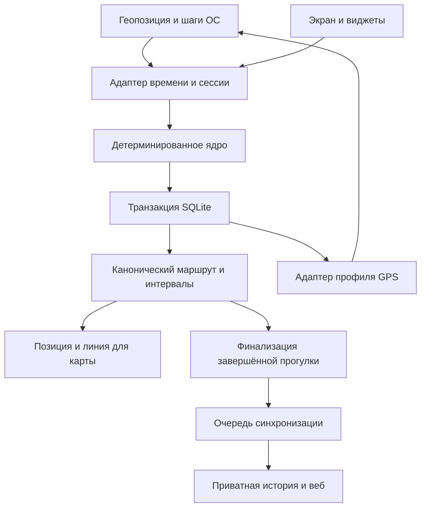
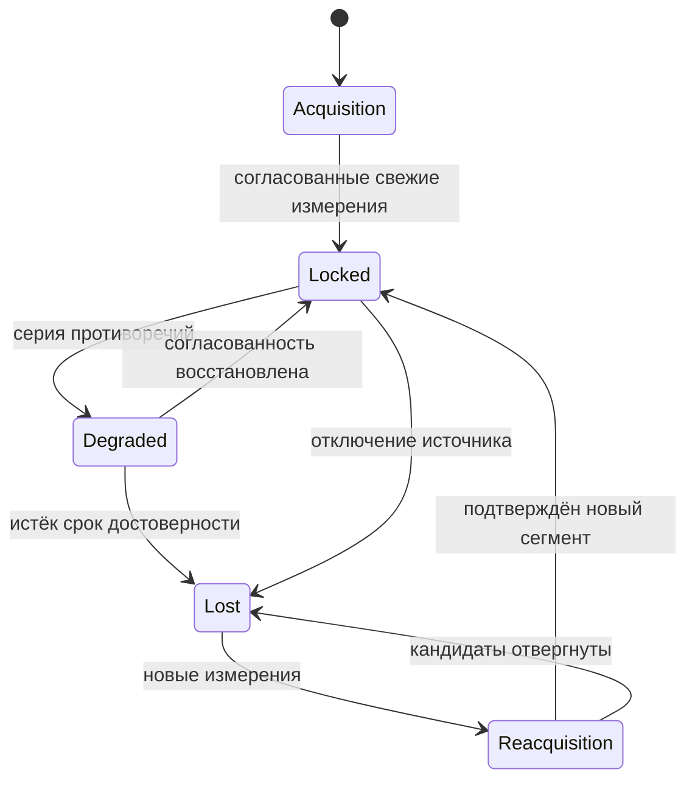

# GAFUS · Smart Tracking прогулок с собакой

Технический план второго этапа · 25 ноября 2026 · Android, iOS и веб-история. Адресаты — разработчик и независимый QA. База аудита — рабочее дерево `gafus-refactor`, HEAD `8204d236d`, включая локальную реализацию первого этапа.

**С чего начать.** Зафиксировать воспроизводимые ошибки первого GPS-захвата и медленных разворотов, затем собрать синхронные полевые записи на Galaxy A53 и физическом iPhone. Первые кандидаты для сравнения — улучшенный захват/восстановление и подтверждение движения шагами на том же временном интервале. Смена фильтра, снижение частоты GPS и привязка к карте — отдельные эксперименты. Каждый должен выиграть у текущего кандидата v2 median на отложенных прогулках.

**Смысл записи.** Телефон измеряет путь владельца. Пока собака нюхает траву, прогулка продолжается. Во дворе человек может пересечь газон, развернуться на месте или вернуться по собственной линии. Пропуск наблюдений должен оставаться видимым. Длина, оценённая по шагам, может дополнить статистику без появления вымышленной линии на карте.

## 1. Что фактически работает

| Участок | Что проверено в рабочем дереве | Что требуется во втором этапе |
|---|---|---|
| Общее ядро | Чистый reducer, v1 и две конфигурации v2. У v2 окно перестановки 2 с / до 64 элементов, окно движения до 12, порог accuracy 25 м, разрыв после 35 с между годными fix. После разрыва нужны два согласуемых наблюдения. Медиана по трём принятым позициям отстаёт на одну принятую точку, имеет защиту разворота. | Сохранить эталоны и декодеры. Пересмотреть захват первой пары, систематический дрейф и короткие выходы из кластера. В событиях пока нет шаговых интервалов, отдельной точности скорости и монотонного времени источника. [Типы](../../packages/core-client/src/walk-tracking/types.ts) · [ядро](../../packages/core-client/src/walk-tracking/engine.ts) · [движение](../../packages/core-client/src/walk-tracking/motion.ts) · [медиана](../../packages/core-client/src/walk-tracking/smoothing.ts) |
| Старт и фон | Экран ждёт ответ по разрешению шагомера перед созданием прогулки. После создания запускаются адаптеры и GPS. Есть старт/пауза с виджетов и headless-задача `gafus.dogwalk.gps.v1`. Callback получает системное время измерения, проставляет общее `Date.now()` получения пачки. При ошибке задачи записывается обезличенная ошибка. | Фиксировать момент нажатия и сессию до ожидания датчиков. Отличать задержанную историческую пачку, старый стартовый fix, снятие разрешения и действительно потерянный сигнал. Проверить смену владельца и гонки с виджетом. [Экран](../../apps/mobile/app/(main)/walk.tsx) · [задача](../../apps/mobile/src/features/walk/walkGpsTask.ts) |
| Шаги | Android-мост выдаёт накопительный снимок на владельца и прогулку, тип counter/detector, running и incomplete. Сервис хранит состояние и распознаёт сброс счётчика. На iOS приложение запрашивает шаги Core Motion через Pedometer за интервал. Длина по умолчанию 0,8 м на шаг. | Снимок Android не содержит времён отдельных шагов. Отложенный итог за всю прогулку нельзя поминутно распределять по разрывам. Проверить границы, задержки, положение телефона и пропуски независимо на обоих устройствах. [Мост](../../apps/mobile/src/features/walk/androidBackgroundSteps.ts) · [нативное состояние](../../apps/mobile/native/android-walk/src/ru/gafus/app/walk/DogWalkStepState.java) · [модель](../../apps/mobile/src/features/walk/walkModel.ts) |
| SQLite и восстановление | WAL, exclusive-транзакции, одна активная GPS-сессия, таблица checkpoint, журнал, точки, курсор и tombstone. В v2 подтверждённые точки, метры и checkpoint пишутся атомарно. Настройка shadow/v2 читается при первом создании **GPS-сессии**. Старые GPS-сессии без checkpoint работают на v1. При повреждении checkpoint создаётся новый сегмент. | Привязать выбор к созданию самой прогулки: GPS может быть включён позднее или после OTA. Не пропускать будущую версию через recovery старого декодера: он принимает только v2/config 1–2. Защитить от потери хвоста при поздней паузе и от смены варианта при восстановлении. [Хранилище](../../apps/mobile/src/features/walk/walkGpsStorage.ts) |
| Частота | Профили v1 walking/slow/stationary — 4/8/20 с и 5/10/25 м. Есть выдержки и cooldown. v2 сохраняет walking. Android использует location FGS, iOS — Fitness, auto-pause и deferred delivery. | Измерить, сколько начальных метров теряется, когда после стоянки ОС ждёт 25 м. Профиль с фиксированными параметрами остаётся контролем. [Политика](../../apps/mobile/src/features/walk/walkAdaptiveGps.ts) · [параметры ОС](../../apps/mobile/src/features/walk/walkGpsTask.ts) |
| Экран и веб | Общая сегментированная геометрия, RDP в метрах с чанками по 256 вершин, допуск 2 м, ограничение 100 000 точек. Live-экран читает новые seq каждые 5 с, копирует накопленный массив и строит GeoJSON вновь. Системный маркер и линия уже разделены. | Измерить задержку реального кадра и стоимость повторной сборки. Выводить возраст и радиус именно той позиции, которую показывает маркер. [Геометрия](../../packages/core-client/src/walk-tracking/geometry.ts) · [мобильная карта](../../apps/mobile/src/features/walk/WalkRouteMap.tsx) · [веб](../../apps/web-vite/src/features/walks/WalksConnectedPage.tsx) |
| История и синхронизация | Завершённая прогулка загружается до точек. Клиент посылает до 150 точек за раз, API принимает до 200. Курсор — seq, сервер применяет `createMany(skipDuplicates)`. При наличии gpsMeters legacy-поле estimatedMeters на отправке содержит GPS, иначе шаги × 0,8. При чтении клиент восстанавливает gpsMeters и steps, отдельную сохранённую персональную оценку не восстанавливает. | Отдельный версионный контракт для новых агрегатов или финальной ревизии. Повторная отправка изменённой координаты с тем же seq её не обновит. [Синхронизация](../../apps/mobile/src/features/walk/walkSync.ts) · [strict DTO](../../apps/api/src/routes/v1/walks.ts) · [сервер](../../packages/tracking-server/src/walksService.ts) |

### Воспроизведение первого этапа

Общий пакет собран из проверенного дерева. Под Node 22 запущены Vitest для `core-client/src/walk-tracking` (13), `mobile/src/features/walk` (112 с реальной SQLite), `web-vite/src/features/walks` (5), API walks (13) и tracking-server walksService (3). **146/146 прошли.** Команда `node scripts/qa/walk-gps-replay.mjs --require-synthetic` воспроизвела сохранённый JSON байт в байт. В нём 8 сценариев, 6 автоматических условий и `fieldAcceptance: not_run`. Фикстура стоянки покрывает 10 минут. Это данные для воспроизведения, полевого вывода из них нет. [Исходный план](walk-gps-tracking-refactoring-plan.md) · [отчёт реализации](walk-gps-tracking-implementation-20261125.md) · [replay](../../scripts/qa/walk-gps-replay.mjs) · [эталон](walk-gps-replay-20261125.json)

| Контроль | Истина | v1 | v2 без сглаживания | v2 median |
|---|---:|---:|---:|---:|
| Стоянка с чередованием координат | 0 м | 2 250 м | 0 м | 0 м |
| Медленная прямая | 180 м | 169,2 м | 180 м | 180 м |
| Квадрат с шумом | 160 м | 187,947 м | 201,198 м | 173,517 м |
| Разрыв 60 с, только наблюдённые плечи | 15 м | 95 м | 15 м | 15 м |

На шумном квадрате ошибка расстояния рабочего median равна +8,45%, RMSE позиции 2,562 м. В replay есть отдельная лабораторная медиана, которая даёт 175,353 м. Сравнивать в релизном тесте нужно выход полного движка, включая обнаружение движения и flush.

**Три дополнительных прогона на неизменённом v2 median.** Для повторения создать checkpoint с config 2, передавать `fix` каждые 4 с, затем `finish` на времени последнего fix. Точки лежат на экваторе: latitude = 0, longitude = x × 180/(π × 6 371 008,8), timestamp = 1 800 000 000 000 + t × 1 000, receivedAt = timestamp, course отсутствует. Это проверки границ алгоритма, частоту подобных ошибок у реальных пользователей они не измеряют.

| Сценарий и вход | Истинная длина | Получено | Как использовать |
|---|---:|---:|---|
| Неподвижный телефон. Первый x = 60 м, далее 10 точек x = 0. Speed = 0, accuracy = 5 м. | 0 м | **60 м** | Неудачная стартовая точка остаётся кандидатом. Через 8 с допустимое смещение выросло, и ложное плечо попало в запись. Обязательный P0-тест. |
| Неподвижный телефон, согласованный дрейф. x = 1,2 × i, i = 0…20, speed неизвестна, accuracy = 5 м. | 0 м | **16,8 м** | Дрейф похож на медленную ходьбу. Парная фикстура с теми же GPS и разными шаговыми свидетельствами. При отсутствии свидетельств измерять честность статуса «неопределённо». |
| 4,2 м вперёд и обратно. x = 0,7 × min(i, 12 − i), i = 0…12, speed неизвестна, accuracy = 8 м. | 8,4 м | **0 м** | GPS сам по себе слабо различает стоянку и эту прогулку. С полными шаговыми данными проверять учёт движения или оценку за интервал, без них — отсутствие ложной уверенности и выдуманного разворота. |

## 2. Что взять у других продуктов

Средняя колонка описывает публичный источник. Последняя — проектное предложение для GAFUS и предел его применимости. Веса фильтров и внутренние алгоритмы коммерческих продуктов неизвестны.

| Источник | Документированное поведение | Применение и ограничение |
|---|---|---|
| Garmin | SatIQ выбирает режим спутников с учётом среды. Auto Pause может останавливать таймер. TracBack использует записанный след. | Адаптировать доступные ОС запросы и измерить экономию. Разделить остановку человека и ручную паузу. Развернуть собственный след для возврата. Управление диапазонами GNSS часов телефону недоступно через текущий мост. [SatIQ](https://support.garmin.com/en-US/navionics/faq/wgKpMjTlpV29AQB5PVvTL9/) · [Auto Pause](https://www8.garmin.com/manuals/webhelp/GUID-BD965919-30AA-4EB5-95D7-A899658C50EB/EN-US/GUID-FFC7856F-65F9-4B3C-93E4-8348CA65E6CF.html) · [TracBack](https://support.garmin.com/en-CA/?faq=f6PIOm1qM34z8NX1vX64AA) |
| Suunto | FusedSpeed сочетает GPS с ускорением запястья. FusedTrack на Suunto 9 дополняет редкие GPS-замеры сенсорами в отдельных режимах бега. | Сравнить скорость и шаги как признаки движения. Положение телефона меняется, поэтому экономию и точность часов нельзя переносить на прогулку. [FusedSpeed](https://cms-www.suunto.com/en-us/Support/Product-support/suunto_9/suunto_9/features/fusedspeed/) · [FusedTrack](https://cms-www.suunto.com/en-us/Support/Product-support/suunto_9/suunto_9/features/fusedtrack/) |
| Apple, Polar | Apple Watch калибрует шаг на улице при хорошем GPS и разных скоростях. Polar описывает GPS-калибровку дистанции по движениям запястья. На iPhone доступны отдельные API Core Location и CMPedometer. | Обучать персональную длину шага на качественных интервалах, отдельно по темпу и устройству. Телефон в рюкзаке требует отдельной проверки. WatchKit/HealthKit для этого этапа не нужны. [Apple Watch](https://support.apple.com/en-in/105048) · [Core Motion](https://developer.apple.com/documentation/coremotion/cmpedometer) · [Core Location](https://developer.apple.com/documentation/CoreLocation/getting-the-current-location-of-a-device) · [Polar](https://support.polar.com/en/speed-and-distance-from-the-wrist-with-gps-calibration?category=features) |
| Google | FLP объединяет системные источники. Activity Recognition выдаёт переходы активности. Google описывает использование 3D-моделей для коррекции отражений в поддерживаемых условиях. Android Location имеет монотонное время измерения. | Принимать результат системного провайдера с неопределённостью. Проверять свежесть; не предполагать конкретного покрытия города РФ, работы Google Play services или доступности сырых спутниковых измерений. [FLP и фон](https://developer.android.com/about/versions/oreo/background-location-limits) · [переходы](https://developer.android.com/develop/sensors-and-location/location/transitions) · [3D-коррекции](https://android-developers.googleblog.com/2020/12/improving-urban-gps-accuracy-for-your.html) · [Location](https://developer.android.com/reference/android/location/Location) |
| Strava | Различает elapsed/moving time, документирует перерасчёт дистанции и различия с исходным устройством. | Показать пользователю длительность прогулки и при достаточном покрытии время движения. Версионировать результаты финальной обработки. Порог для бега может скрыть движение около собаки. [Время](https://support.strava.com/en-us/articles/15401804-moving-time-speed-and-pace-calculations) · [дистанция](https://support.strava.com/en-us/articles/15401893-how-distance-is-calculated?mobile_site=true) |
| COROS | Индикатор захвата GPS перед тренировкой, возврат по ранее пройденному следу. | Начинать таймер сразу, отдельно показывать готовность записи. При возвращении учитывать последовательность сегментов и петель. [Захват](https://support.coros.com/hc/en-us/articles/360040347211-Starting-Pausing-and-Finishing-Workouts) · [Back to Start](https://support.coros.com/hc/en-us/articles/360040903771-Back-to-Start-Feature-Explained) |
| 2ГИС, Яндекс | У 2ГИС есть пешеходная навигация и отдельный объект положения. Открытый Map Matching API реконструирует автомобильную поездку по дорогам. MapKit Яндекса предоставляет отдельный объект визуализации пользователя и круга точности. | Заимствовать независимое отображение позиции, точности и записанного пути. Это позволяет оставить честный разрыв на траве или параллельном дворовом проходе. [2ГИС Навигация](https://docs.2gis.com/en/ios/sdk/examples/navigation) · [2ГИС Map Matching](https://docs.2gis.com/en/api/navigation/map-matching/overview) · [Яндекс UserLocationView](https://yandex.ru/maps-api/docs/mapkit/com/yandex/mapkit/user_location/UserLocationView.html) |
| Mapbox | Различает исходную и enhanced location. Map Matching API предлагает walking-профиль и оценку совпадения с сетью. | Сравнить display-положение с canonical. Сетевой сервис принимает координаты, имеет тарификацию и ограничения запросов; для живой записи обязательного обращения нет. [Положение](https://docs.mapbox.com/android/navigation/guides/device-location/) · [API](https://docs.mapbox.com/api/navigation/map-matching/) · [цены](https://www.mapbox.com/pricing) |
| HERE, TomTom | HERE Route Matching и TomTom Snap to Roads описывают восстановление пройденного пути по дорожной сети. | Полезный отрицательный контроль на маршруте через газон. Для дефолтной геометрии прогулки нет основания покупать дорожный сервис. [HERE](https://docs.here.com/routing/docs/intro-route-matching) · [TomTom](https://docs.tomtom.com/snap-to-roads-api/documentation/product-information/introduction) |
| Komoot, AllTrails | Komoot позволяет заранее скачать маршрут и карту. AllTrails предупреждает об отклонении от выбранного маршрута. | Собственный сохранённый след должен работать офлайн. Предупреждать об отклонении только в явном режиме возврата. Обычная прогулка свободна, загруженные тайлы и доступность линии — разные возможности. [Komoot](https://support.komoot.com/hc/en-us/articles/10356476920986-Download-routes-and-maps-for-offline-use) · [AllTrails](https://support.alltrails.com/hc/en-gb/articles/37213407013908-Wrong-turn-alerts) |
| OSM, Valhalla, GraphHopper, OSRM | OSM предоставляет данные под ODbL. Valhalla Meili имеет пешеходные параметры ошибок и переходов. GraphHopper публикует HMM-реализацию. OSRM Match поддерживает разбиение следа, unmatched-точки и confidence. | Самостоятельно сравнить кандидатов на одном версионном срезе карты РФ. Вычислить долю отсутствующих дворовых путей. Возможен локальный эксперимент без передачи координат поставщику. [OSM](https://www.openstreetmap.org/copyright) · [Meili](https://valhalla.github.io/valhalla/contributing/architecture/meili/configuration/) · [GraphHopper](https://github.com/graphhopper/map-matching/blob/master/hmm-lib/README.md) · [OSRM](https://project-osrm.org/docs/v5.24.0/api/#match-service) |
| Tractive, Fi, DogLog | У Tractive WALK использует GPS телефона, LIVE — трекер на ошейнике. Fi рядом с трекером может использовать местоположение телефона. DogLog документирует события, совместный журнал и привычки. | Явно подписывать «маршрут прогулки с телефоном». Дневник и остановки ценны сами по себе. Шаги владельца нельзя превращать в метры или активность животного. Алгоритм GPS DogLog в приведённом источнике не описан. [Tractive](https://help.tractive.com/hc/en-us/articles/19942936227730-What-is-the-difference-between-LIVE-and-WALK-on-the-map-screen) · [Fi](https://support.fitracking.com/hc/en-gb/articles/360043929694-Enable-Location-Services-on-the-Fi-App) · [DogLog](https://www.doglogapp.com/) |

### Исследования и пределы переноса

* Newson и Krumm формализуют HMM-сопоставление наблюдений с графом через ошибки позиции и правдоподобие переходов. В опыте GAFUS добавить явное состояние вне графа и возможность отказа. Исходная работа о дорожных трассах. [Работа авторов](https://www.microsoft.com/en-us/research/publication/hidden-markov-map-matching-noise-sparseness/?lang=ja)
* Weng и соавт. (2025) исследуют GNSS пешехода с ограничением по тротуару в городском каньоне. Qian и соавт. (2026) исследуют ограничения PDR в сочетании с 3D-моделями зданий и видимостью спутников. Оба подхода дают содержательные городские тесты. Первый предполагает пригодность тротуарного графа, второй требует входов, которых текущий JS callback не получает. В P1 изучаем устойчивое смещение при формально хорошем accuracy. Точность из статей не является SLA GAFUS. [Sidewalk matching](https://doi.org/10.1186/s43020-025-00159-8) · [PDR и shadow matching](https://www.mdpi.com/2076-3417/16/21/10729)
* Исследования GNSS/PDR на телефоне рассматривают положение устройства и ошибку направления. RoNIN публикует датасет и модели инерциальной навигации. Применение в GAFUS требует проверки на переноске в руке, рюкзаке и кармане и на прогулках новых людей. Использовать в P3 как внешний контроль; сырая IMU и вычислительная нагрузка увеличивают стоимость решения. [GNSS/PDR на мобильном устройстве](https://www.mdpi.com/2072-4292/13/8/1567) · [RoNIN](https://ronin.cs.sfu.ca/)

## 3. Целевая архитектура и время

**Версия закрепляется до первого асинхронного запроса.** Команда старта создаёт журнал, идентификатор и версию engine/config, профиль сенсоров, время старта и состояние доступа. Таймер и countdown начинаются сразу. Запуск GPS и шагов завершается независимо: отказ или зависание одного источника даёт соответствующий статус. Виджеты вызывают ту же операцию без диалога разрешений. Если старый журнал уже активен и не содержит версии, использовать совместимый режим этой прогулки до завершения.

**Часы.** Хранить measuredAt и receivedAt отдельно, плюс монотонную метку с идентификатором загрузки устройства, когда она доступна. Возраст live-позиции считается на доставке, порядок внутри истории — по времени измерения. Часы процесса через JS пригодны для интервала обработки и кадра. Они не восстанавливают исходное монотонное время измерения и не переходят между перезапусками. Скачок wall clock, перезагрузка или неоднозначное соответствие шкал закрывают непрерывность. Не переносить последний вектор скорости через границу часов. Системная метка Android потребует экспорта из native-моста. На iOS проверить доступные метки именно для данного источника, синхронизацию Core Motion и CLLocation.timestamp; не приписывать CLLocation идентичную Android шкалу.

**Упорядочение.** Переиспользовать буфер v2 и стабильный выбор дубликата. Закрепить tie-break для fix, шагов и команд с одинаковым временем, например пауза закрывает активный интервал в момент T, измерение в T относится только к одной стороне. Интервалы полуоткрытые. Обрабатывать возраст для истории и live независимо: пачка из фона, измеренная в активной epoch, пригодна для записи после задержки; старый fix не становится текущим маркером. При переполнении буфера считать опоздания и версию политики, ограничить память. Если native callback не связывает источник с epoch, использовать owner/walk, время и закрытую границу в SQLite; неразрешимую неоднозначность отклонять. Нельзя реконструировать принадлежность по одному времени получения.

### Состояния и события

Хранить три ортогональных состояния: жизненный цикл (идёт / ручная пауза / завершена), качество захвата и движение (неясно / возможная остановка / стоит / медленно идёт / идёт / бежит). Это позволяет, например, хранить одновременно «прогулка идёт, GPS потерян, шаги подтверждают движение».

| Событие | Переход и действия |
|---|---|
| Старт / возобновление / восстановление после прерывания | Пустое окно кандидатов и новая epoch при утрате непрерывности. Системная приблизительная позиция допускается для ориентирования с собственным возрастом и радиусом. Первая подтверждённая вершина нового сегмента даёт 0 м. |
| Smart GPS Lock | Проверить время, границы координат и reported accuracy, сравнить 2–3 независимых по времени fix в коротком окне. Выбрать согласованный кластер/траекторию с учётом обеих погрешностей и движения. Исключить одиночный старый кандидат при серии новых точек. На чистом старте сохранить подтверждённое начало ходьбы; не начислять расстояние от последней известной позиции ОС. Кандидаты для replay: 2 из 3 и 3 из 4, окно 6–12 с, возраст для live 5–10 с, потолок accuracy по режиму. Широкий радиус не может автоматически подтвердить крупный скачок. |
| Снижение качества / восстановление | Один выброс снижает доверие. Последовательные плохие fix, явный отказ ОС или превышение порога относительно запрошенной частоты прекращают начисление. На экране тишину callback отмечать по возрасту даже без новой точки. Порог сегмента проверить отдельно при паузе iOS и пакетной доставке. После потери подтверждать новый кластер, сохранять пустоту до него. |
| Возможная остановка / движение | Сначала простой автомат с двумя порогами и длительностью пребывания. Признаки — сдвиг относительно погрешности, устойчивость за окно, скорость при валидном источнике и при наличии полный интервал шагов. Сохранить ограниченный хвост возможного начала движения. Нулевой прирост шагов информативен только при работающем счётчике. Поворот и выход из стоянки проверять на коротком окне. Признак курса при очень малой скорости обесценивать. |
| Ручная пауза / finish | Закрыть интервал по времени команды, дренировать допустимый хвост, разорвать сегмент, сохранить результат до остановки подписки. Отдельно испытать позднюю паузу, когда медиана уже использовала будущую точку: простое удаление строк позже T может оставить искажённую вершину до T. Пересчитать из ограниченного незакрытого хвоста либо запретить фиксацию зависимых от будущего строк до безопасной границы. Повтор команды идемпотентен. |

Стартовые параметры в этом документе — гипотезы для испытаний. HMM для движения оценивать позднее, если таблица ошибок автомата покажет системные перепутывания классов и будет разметка. HMM движения и HMM привязки к графу решают разные задачи.

### Контракты чистого ядра

Типы ниже описывают границы будущих данных. Физические таблицы добавлять только на этапе, который их использует.

| Тип | Основные поля и семантика |
|---|---|
| RawObservation | Источник, session/epoch, измеренное и полученное время, возможная монотонная пара, lat/lon, accuracy, опциональные speed/course и их неопределённость. Ноль скорости не подставлять вместо отсутствующего значения. |
| StepInterval | owner/walk/epoch, [from,to), delta, source, complete, clockGeneration, identity/cursor. Два снимка одного счётчика дают интервал только в рамках той же сессии без сброса. Перекрывающуюся дельту нельзя делить равномерно без данных. |
| PositionEstimate | Положение в локальной метрической системе, время, неопределённость и доступность источника. Прогноз внутри фильтра имеет отдельный признак происхождения. |
| ConfidenceEvidence | age, horizontal accuracy, инновация/остаток относительно модели, согласие соседей, шага, скорости и курса, полнота источников, давность последнего good. Отдельные оценки `position`, `motion`, `outlier`, причины и класс: reliable / low / estimated / unknown. |
| CanonicalPoint / интервал покрытия | Существующие seq, segment, измеренное время, подтверждённая координата и deltaMeters. Соседний интервал хранит покрытие и источник дистанции. Для разрыва возможен интервал без координат. |
| WalkSummary | confirmedGpsMeters (null или ≥0), gapEstimatedMeters, unknownDuration, moving/stopped/manualPause/active, полнота шагов, coverage, версия измерений. Различать отсутствие оценки и измеренный ноль. |
| DisplayLocation | Координата выбранного источника, timestamp, accuracyRadius, stale, допустимый режим интерполяции. Кадры маркера, прореживание линии и изменения масштаба не пишут GPS-точки и метры. |
| Checkpoint и FinalRevision | Schema/engine/config/stride-model version, epoch, watermark, ограниченные хвосты, seq, агрегаты, cursor шагов. Финальный результат получает inputRevision, algorithmVersion, status и идентификатор опубликованного результата. |

**Как действует confidence.** Начать с прозрачных правил и причин, отдельно нормируя погрешность ОС на данных каждого телефона. Проверять согласие перемещения с прошедшим временем и с размером области неопределённости. Уменьшать доверие при длительном смещении вдоль фасада с противоречащими шагами; учитывать корреляцию соседних GPS и связь speed с тем же провайдером. Высокое доверие разрешает метры и обучение шага. Низкое удерживает кандидат и исключает из обучения, estimated разрешает только оценку в статистике. Unknown открывает разрыв. До калибровки на независимой выборке не показывать эвристический score как проценты вероятности. Для вероятностной версии смотреть reliability diagram, Brier score и покрытие 68/95%-областей по среде и ОС.

## 4. Какие алгоритмы проверять

Фильтры работают внутри сегмента, в локальных метрах с реальным Δt. Центр локальной проекции обновлять контролируемо; проверить долготу ±180°, высокие широты, разный шаг дискретизации, дубликаты. Метры считать до округления. Общие источники по линейным/нелинейным моделям и сглаживанию — [Särkkä и Svensson](https://users.aalto.fi/~ssarkka/pub/bfs_book_2023_online.pdf), [оригинальная работа Savitzky–Golay](https://doi.org/10.1021/ac60214a047).

| Метод | Где испытывать / ожидаемая польза | Основная ошибка и решение |
|---|---|---|
| v2 baseline, median-3 | Обязательные контроли полного pipeline. Медиана подавляет краткий выброс. | Центрированная медиана ждёт следующее принятое движение, может долго ждать на остановке. Измерять задержку и поворот с/без курса. |
| EMA, адаптивный EMA | Дешёвый causal-контроль для маркера и live. Вариант с коэффициентом из Δt, скорости и качества. | Срезает углы и запаздывает. На тестовом квадрате EMA(0,5) дала 156,369 м, но максимальная ошибка угла 5,684 м. Близость итоговых метров недостаточна для выбора. |
| Alpha–beta | Дешёвая модель положения и скорости с переменным Δt, P1-соперник медианы. | На остановке прогноз может продолжать движение. Сбрасывать скорость при подтверждённой стоянке; прогнозируемые метры не записывать. |
| Линейный Kalman, robust Kalman | Локальная модель [x,y,vx,vy], Q зависит от движения, R — от качества и калибровки радиуса. Отдельно проверить ограниченные веса больших остатков (Huber) и gating по нормированной инновации. | Фиксированный и адаптивный прототипы на квадрате дали 197,209/197,717 м. Сравнить при тех же входных допусках. Ограничить диапазоны R/Q, проверить серию отражений и резкий реальный разворот, исключить самоподтверждающийся отказ. |
| Hampel / медианное абсолютное отклонение | Локальный индикатор единичной аномалии в остатках. Сравнить причинное окно для live и центрированное для финала. | При нулевом MAD нужен нижний предел масштаба. Длинная серия смещения не будет одиночным выбросом. Проверить ложную отбраковку коротких выходов из стоянки. |
| Complementary filter | Короткий контролируемый эксперимент объединения быстрой инерциальной и медленной абсолютной информации, например направления. | Ось телефона, мягкое железо и движение руки искажают heading. Нужны признаки пригодности ориентации и энергетический замер. |
| EKF / UKF | P3 при появлении нелинейной модели шага/курса и синхронного потока сенсоров. EKF линеаризует модель, UKF распространяет сигма-точки. | Оба усложняют диагностику при смене положения телефона; на входе из одних fused fix преимущества заранее нет. Проверять по абляции против линейной модели. |
| Particle filter / HMM | P3 при нескольких спорных путях или состояниях движения. Включить гипотезу off-graph, ограничить число гипотез. | Более высокий CPU и риск ложного выбора красивой дорожки. Должен выигрывать у простого автомата с отказом от решения. |
| Savitzky–Golay / двунаправленное сглаживание / RTS | P2 offline, только внутри непрерывной записи. RTS использует прямой проход и обратный пересчёт по модели. Сравнить с локальной фильтрацией одиночных аномалий. | Нерегулярные времена, границы сегментов и короткие углы ограничивают применимость; регуляризацию времени не трактовать как новые наблюдения. Для длинного трека использовать блочную обработку с перекрытием и проверкой шва. |
| PDR, ZUPT, learned inertial odometry | P3. Шаговая модель может оценить длину без GPS. Для нулевой скорости проверить, что сам телефон действительно неподвижен. | У обувного датчика есть фаза опоры, у телефона в руке её нет. Запрещать интегрирование инерциального прогноза в канонический маршрут. ML оценивать на других людях, телефонах и способах переноски; сравнивать стоимость энергии и отказа. |

Порядок сравнения: (1) одинаковые нормализованные входы и motion gate для изоляции фильтра; (2) полные pipelines с одинаковыми командами; (3) абляция «без шагов / без курса / без скорости / без карты»; (4) поле и энергия. Побеждает самый простой кандидат, выполняющий все ограничения и показывающий заранее заданный выигрыш на независимых данных.

### Сенсоры, персональная длина шага и статистика

| Источник | Первое применение | Ограничение |
|---|---|---|
| GPS, speed, course | Захват, движение и неопределённость. | Значения одного системного решения коррелируют. Курс при медленном движении слаб. Accuracy — оценка ОС, систематическое смещение возможно и при малом радиусе. |
| Шагомер, системная активность | При совпадении времён помогают распознать старт/стоянку. | Шаги на месте не подтверждают пройденные метры. Отказ доступа, сброс и редкий snapshot дают unknown. Активность через имеющийся Expo watcher ограничена foreground; поддержка конкретного бинарника проверяется отдельно. |
| Акселерометр и гироскоп | В пилоте короткие окна для признака покоя и смены ориентации в foreground. | Рука с поводком и движущийся рюкзак дают ложное движение. Постоянная запись сырой IMU в фоне требует иного бюджета. |
| Магнитометр | Опциональная проверка надёжности курса при осмысленной ориентации. | Дворы, металл, произвольная ориентация. Изменение азимута телефона не означает поворот человека. |
| Барометр и высота GPS | P3 отдельно исследовать относительный перепад при хорошей вертикальной точности. | Погода, подъезд, дрейф и шум высоты. До контрольных маршрутов с известным профилем набор высоты скрыт. |

**Калибровка.** Первое приближение — 0,8 м с подписью «по шагам». Профиль локальный, по владельцу, устройству и типу сенсора. Для slow/walk/run использовать отдельные корзины, выбирать по достоверному темпу/каденсу. Считать длину шага как подтверждённое GPS-расстояние / число шагов на одном полностью покрытом окне. Начальные кандидаты окон — 30–120 с и ≥30 шагов. Исключать паузы, смешанный темп, повороты с плохим покрытием, неполный счётчик, стоянку, большие инновации и использование шаговой оценки в GPS-эталоне. Обновлять устойчивой медианой отношений или ограниченным взвешенным средним, хранить эффективное число окон, разброс и давность. Готовность корзины проверить после ≥5 независимых окон минимум в двух прогулках. На редком темпе сохранять общий prior. Сброс модели доступен пользователю, удаление аккаунта очищает профиль. Повторная обработка одного интервала не обучает второй раз.

**Учёт расстояния.** Разбить активное время на непересекающиеся интервалы. На каждом выбрать один источник: подтверждённое GPS / полная шаговая оценка на разрыве / неизвестно. Шаговая оценка на интервал с неизвестной долей шагов не выдаётся. `итог ≈ Σ GPS + Σ оценок непокрытых интервалов`; при чистом GPS знак приближения по источнику не требуется. Полный GPS с нулевой дистанцией — 0; при отсутствии годных наблюдений gpsMeters = null. Не складывать шаги всей прогулки с частичным GPS. При отсутствии движения или недостаточности данных выдерживать обе неопределённости. Показательный тест: 100 м GPS + 20 измеренных шагов строго внутри разрыва при длине 0,7 м → 100 м GPS, ≈14 м оценка, ≈114 м итог, линия с разрывом. При неизвестном распределении тех же шагов — 100 м подтверждено и отметка неполной записи.

**Учёт времени и UX.** Elapsed = finish − start; active = elapsed − ручные паузы; active = moving + stopped + unknown с одинаковой шкалой. Общая длительность в существующем интерфейсе сохраняет прежний смысл. Для средней скорости движения делить расстояние только по соответствующим интервалам на их moving time, при нулевом знаменателе показывать прочерк. В карточке достаточно времени, расстояния и шагов. При смешанном результате добавить «≈» и раскрываемую разбивку. Покрытие = секунды с надёжным GPS / active; это доля времени, доля истинной длины по телефону неизвестна. В диагностике — класс качества, точность, время lock, возраст, частота, число смен профиля, причины разрывов. Набор высоты и среднюю скорость при плохом покрытии не показывать.

## 5. Настройка батареи, карты и финальной обработки

**Адаптивный GPS.** Начать с контрольного walking 4 с / 5 м Android и текущих параметров iOS. Сравнить быстрый профиль при захвате, поворотах, старте движения и восстановлении; обычный при стабильном движении; экономичный только при подтверждённой длительной стоянке. Для опыта сравнить 2–4 с / 2–5 м при поиске и 8–15 с / 5–10 м на стоянке против существующих 20 с / 25 м. На iOS менять только поддерживаемые параметры, отдельно A/B auto-pause и deferred delivery. Короткое движение 3–10 м после ухода в экономию — обязательный тест. Оставить контроль с энергосбережением, отключённым на весь сеанс.

Порог покоя для изменения профиля выше порога классификации остановки; начальные выдержки — 45–90 с вниз, ускорение на первом надёжном признаке старта, cooldown для повторного понижения ≥30 с. Смена профиля выполняется после SQLite commit с повторной проверкой owner/walk/epoch. Сохранять последнее успешное применение, отслеживать выпадение точек при перезапуске подписки, возвращаться к рабочему профилю при ошибке. Экран off удешевляет отрисовку; сам по себе он не доказывает неподвижность. Уровень заряда, режим питания и длительность использовать как модификаторы бюджета только при доступном источнике. Если нет гарантированного способа проснуться при коротком перемещении, оставлять более частый профиль. Постоянный JS-таймер в фоне не использовать как будильник. [Ограничения Android](https://developer.android.com/develop/sensors-and-location/location/battery/scenarios) · [параметры и ограничения SDK](https://docs.expo.dev/versions/v57.0.0/sdk/location/)

**Live → final.** В первой поставке пользовательские GPS-метры и канонические вершины замораживаются при finish. После этого можно улучшить только производную геометрию для показа, с отдельной версией и возможностью восстановить её из canonical. Начать с проверки локальных аномалий внутри сегмента. Full RTS на всех сырых наблюдениях невозможно воспроизвести из того, что v2 сейчас сохраняет. Варианты опыта: добровольный QA-захват с TTL либо сохранение ограниченных достаточных состояний фильтра с явной стоимостью на час. По умолчанию использовать только канонические данные и доступный хвост. Если пользователь видит разные версии линии на двух устройствах, получать одинаковое представление из одной версии геометрии или явно передавать версию.

Для будущей **замены** canonical, если появится доказанный выигрыш, сначала добавить серверную ревизию и API. Ключ работы = (owner, walk, inputRevision, algorithm, config). Новые строки пишутся в staging, после проверки метрик транзакция переключает указатель и кладёт согласованный summary в outbox. Читатели до переключения видят старый полный результат. Для сервера — загрузка новой версии пачками, контроль числа/хеша, атомарная публикация и курсор, привязанный к ревизии; конфликт старой версии не перетирает новую. Сбой или tombstone отменяет работу, повтор даёт тот же результат. До этой миграции загруженные seq неизменяемы. Первое включение финала допускает ровно 0 м изменения пользовательской статистики. Для любого будущего изменения метров показывать происхождение, live/final-разницу, отдельно получать продуктовое решение о допустимом расхождении и проверять старый клиент.

**Маркер и длинная карта.** Разделить положение сейчас, последнюю подтверждённую вершину и текущую отрисованную позицию. Интерполировать только внутри короткой непрерывной пары, ограничивая задержку; после таймаута остановить анимацию, указать возраст и радиус последнего измерения. Приближённая геолокация даёт широкий радиус и объяснение статуса. У исторической карты нет живого маркера. Для длинной прогулки кешировать завершённые чанки, пересчитывать только хвост, включить смену масштаба в ключ геометрии, сохранять границы, экстремумы разворотов и разные сегменты. В фоне карту не перестраивать. Сравнить результат полной и инкрементальной обработки, стоимость React-копий и передачи в MapLibre. Изменение tolerance не меняет ни одного метра.

**Вероятностная привязка к карте — P3.** Испытать на предварительно загруженном фрагменте пешеходного графа РФ. Гипотезы включают ближайшие несколько рёбер и движение вне графа. Веса — расстояние поперёк ребра относительно неопределённости, проходимость, допустимая длина перехода за Δt, устойчивый курс и разница между двумя лучшими путями. Рядом с параллельной улицей или при слабом преимуществе возвращать «неопределённо». Никогда не заполнять пропущенный участок по графу. Результат — переключаемое представление только для QA, исходный canonical сохраняется. Сравнить двор без тропы, параллельные дорожки в парке, разные стороны забора, проход через арку, временно закрытый проход и полностью пустую карту.

Считать стоимость в рублях на 1 000 прогулок по реальным точкам/батчам, запросам и тарифу на дату пилота; для собственного сервиса — подготовка тайлов, RAM, диски, трафик и обновления. Проверить покрытие минимум двух российских городов и одного лесопарка, доступность с обычного мобильного интернета РФ, ключи/условия хранения и отображения результатов. Открытые данные OSM и лицензия программы — отдельные объекты; проверить атрибуцию и условия ODbL для поставляемой производной базы, лицензию движка и условия тайлов. Коммерческий маршрутный API получает координаты и требует сети. Сначала offline/self-host QA на синтетике; внешний запрос на пользовательских координатах в обычный сценарий не включать. Без подтверждённого выигрыша на покрытом графе и нуля принудительных переносов off-graph в контрольном наборе этап заканчивается отказом от интеграции. [OSM](https://www.openstreetmap.org/copyright) · [Valhalla и ограничения пешеходного matching](https://valhalla.github.io/valhalla/api/map-matching/api-reference/) · [Mapbox](https://docs.mapbox.com/api/navigation/map-matching/)

**Возврат к началу — отдельная P2-функция.** Считать по сохранённым сегментам в обратном порядке, включая текущий подтверждённый хвост. Хранить индекс вершины и накопленную длину по сегменту. Проецировать текущую годную позицию на локальное окно около предыдущего прогресса. На восьмёрке использовать порядок, курс и гистерезис; при неоднозначности остановить пересчёт до следующего наблюдения. Не позволять ближайшей точке с другой петли мгновенно сократить остаток. Показать направление к следующей подтверждённой вершине и расстояние по известному следу. У разрыва указывать «дальше часть пути не записана», считать остаток по непрерывному плечу, раздельно обозначать другие участки. Отклонение подтверждать серией точек с учётом радиуса; пользователю доступно отключение. Без тайлов и сети рисовать собственную линию/направление в локальных координатах. Это не обещание проходимости, освещённости или безопасности пути. Функция читает трек и никак не меняет запись.

## 6. Состав бинарников и граница GAFUS OTA

Проверены локальные файлы: у Android разобраны скомпилированные AndroidManifest и DEX, у iOS — Info.plist, Expo.plist и символы исполняемого файла. Присутствие класса/строки доказывает состав, а частоту работы, наличие аппаратного датчика и доступ к нему при блокировке проверяют на самом устройстве. Эта проверка не определяет фактически установленную ревизию каждого пользователя.

| Проверенный артефакт | Свидетельства | Значение для плана |
|---|---|---|
| iOS 1.7.5 (98), Xcode-архив от 18.11 | Background mode location, описания обоих разрешений Location и Motion, CMPedometer/Core Motion, ExpoLocation, SQLite, TaskManager и сенсорные символы. Production GAFUS manifest, сертификат, runtime 1.7.5, fingerprint начинается с `3424c3c2bf57`. | Основной кандидат для матрицы iPhone. Профиль 98 проверять собственной записью с экрана и из виджета. Наличие методов новой версии SDK по одному имени модуля не гарантируется. |
| Локальная `apps/mobile/gafus-1.7.5.ipa` | Внутри build **101**, те же базовые модули и background modes, собственный manifest и сертификат GAFUS. | Дополнительный образ. Приёмка 101 не заменяет приёмку 98. |
| Android RuStore 1.7.5 (17506), APK | Собственные step service и мост, FLP, ExpoLocation/TaskManager/SQLite, имена Pedometer, акселерометра, гироскопа, магнитометра и барометра. Fine/coarse/background location, activity recognition, location и health FGS. Production GAFUS manifest, сертификат, fingerprint `d9ecf3c85ef2…`. | Кандидат на JS/SQLite-этапы через GAFUS OTA после проверки подписи, полного fingerprint и устройства. Для шагов между разреженными снимками нужны отдельные доказательства. |
| Android Google Play 1.7.6 | В локальных AAB 17601 и base APK 17602 проверены шаговый мост, Location, TaskManager, SQLite, IMU и разрешения на геолокацию и активность. | Целевой заменяющий бинарник получает те же этапы через GAFUS OTA. Полевой прогон выполняется на фактическом Google Play build с его fingerprint, как и для других сборок. |

Матрица ниже относится к проверенному runtime **после** сверки профиля каждой сборки. «OTA» означает JS, который использует уже встроенную возможность; пользовательское разрешение при первом обращении всё равно может потребоваться. Сервер и веб выпускаются независимо. [Нативный профиль](../../apps/mobile/scripts/self-hosted-native-profile.cjs) · [fingerprint](../../apps/mobile/scripts/native-source-fingerprint.mjs) · [проверка конечного файла](../../apps/mobile/scripts/verify-native-ota-artifact.py) · [Pedometer и фон](https://docs.expo.dev/versions/v57.0.0/sdk/pedometer/)

| Улучшение | Android / сборка / разрешения | iOS / сборка / разрешения | Фон и сервер |
|---|---|---|---|
| Версия сессии, lock, confidence, motion, фильтры, display, локальная статистика | OTA, существующая точная геолокация для качества | OTA, существующее разрешение геолокации | Только доставленные GPS-события. Аддитивная SQLite; сервер прежний при прежнем DTO. |
| Интервалы шагов и калибровка | OTA для полных пар доступных снимков. Для timestamped-журнала counter/detector, сохранения между JS-вызовами — новый Android-мост и бинарник, уже объявленное activity recognition. | OTA для доступного исторического запроса CMPedometer с разрешением Motion; сборка потребуется при добавлении собственного timestamped-моста. | Фоновая подписка JS не гарантируется. Локальное обучение возможно без API; сводка на втором устройстве требует API. |
| Системная активность и IMU | Foreground-пилот OTA после feature probe и согласия, при наличии GMS/сенсора. Для Transition API через нативный получатель, журнала и фона — новый Android-бинарник, проверить разрешение и FGS. | Foreground-пилот после проверки метода в 98 и доступа Motion. Собственная обработка Core Motion — новый бинарник; возможность и режим фоновой работы доказать на iOS. | При недоступности вернуть unknown. Непрерывную запись в обычном фоне не обещать ни на одной платформе. |
| Монотонный timestamp источника, наличие/точность speed и bearing | Новый Android-мост к Location, существующее разрешение Location. | Для дополнительных полей CLLocation/связи часов — новый iOS-мост, проверить доступность API и правила фона. | OTA сохраняет любые отсутствующие значения как null. Нативный вариант нужен лишь при доказанной пользе. |
| Адаптивная частота, управление UI при экране off | OTA в пределах существующего FLP/FGS и методов SDK. Аппаратный выбор GNSS диапазона не предусмотрен. | OTA в рамках существующего Core Location, Fitness, distance/deferred/auto-pause. | Проверить потерю данных при смене подписки. Для нового источника уровня заряда проверить бинарник, иначе оставить признак отсутствующим. API не нужен. |
| Финальная display-геометрия и возврат по собственному следу | OTA с текущей картой или локальным выводом линии | OTA с текущей картой или локальным выводом линии | Офлайн из SQLite, вычислять финал при разрешённом окне работы, догонять при открытии. Веб-история требует веб-релиза. |
| Версионная итоговая дистанция / новая каноническая ревизия | OTA после совместимого API | OTA после совместимого API | Аддитивная Prisma/API-миграция, двусторонние контракты, атомарная публикация. До неё — локальный эксперимент или прежняя семантика. |
| Карта-подсказка / барометр / PDR | Локальный эксперимент desktop/replay без приложения; новый SDK/фон/свой движок офлайн в телефоне — оценить и собрать новый бинарник. Барометр foreground — только при runtime probe. | Аналогично; подложка и граф оформляются отдельно. Не добавлять background mode ради эксперимента без проверки применимости. | Обычный маршрут работает без сети. Для сервера с графом отдельный пилот и согласие. Геовысоту в основной API не добавлять на этом этапе. |

## 7. Файлы, миграция и приватность

| Граница | Существующие точки изменения | Предлагаемое изменение |
|---|---|---|
| Общие вычисления | `packages/core-client/src/walk-tracking/{types,engine,motion,smoothing,geometry,index}.ts`, `legacy.ts`, `pagination.ts` | Версионный dispatch. В отдельных файлах второго этапа держать только реализованные функции: evidence/lock, интервал и статистику шага, политику выдачи, позднее final/display и независимый back-to-start. Оставить математику без ОС, SQLite, часов окружения и сети. |
| Хранение и ОС | `apps/mobile/src/features/walk/{walkGpsStorage,walkGpsTask,walkAdaptiveGps,walkStorage,androidBackgroundSteps}.ts`; `apps/mobile/native/android-walk/src/ru/gafus/app/walk/DogWalkStep{Module,Service,State}.java` | Пин версии, добавочные таблицы/колонки с безопасным default, состояния final/outbox, адаптер событий. Нативные файлы менять только после прохождения отдельного опыта. Новый iOS-мост в отдельном mobile native module, только если имеющийся Pedometer недостаточен. |
| UI, запуск и отчёт | `apps/mobile/app/(main)/{walk,walk-route}.tsx`, `apps/mobile/src/features/walk/{WalkRouteMap,WalkWidgetSessionSync}.tsx`, `{walkModel,walkHistoryFormat,androidWalkWidgetActions,iosWalkWidgetActions,walkSync}.ts` в том же каталоге | Единая граница start/pause/finish для экрана и обоих виджетов, честные статусы, раздельные метры и экран возврата. Персональная история должна одинаково читаться из сети и локально. |
| Контракты и веб | `apps/api/src/routes/v1/walks.ts`, `packages/tracking-server/src/walksService.ts`, `packages/prisma/schema.prisma`, `apps/web-vite/src/features/walks/WalksConnectedPage.tsx` | Сначала reader и совместимый endpoint для новой статистики/ревизии, затем writer и веб-показ. До необходимости сохранять существующий wire format. |
| QA | `scripts/qa/walk-gps-replay.mjs`, `packages/core-client/src/walk-tracking/*.test.ts`, `apps/mobile/src/features/walk/walkGpsStorage.sqlite.test.ts`, suite walk/mobile/web, `apps/api/src/routes/v1/walks.test.ts`, `packages/tracking-server/src/walksService.test.ts` | Версионированные fixtures с ожидаемыми границами и эталоном, контролируемая подмена ОС, сбои транзакций, настоящий SQLite/PostgreSQL, сравнение Node/Hermes. |

1. **Миграция чтения.** Зафиксировать v1 и обе конфигурации v2. Новые записи версии вести отдельно от документа, который старый декодер посчитает повреждённым. Например, добавить таблицу по (ownerId, walkId) с generation, immutable engine/config, codec и ссылкой на совместимый writer. Запретить второму writer брать активную прогулку при неизвестном engine. Испытать обновление и возврат на копиях БД v1/v2/shadow, включая активную прогулку без включённого GPS.
2. **Порядок записи.** В одной транзакции приложения привязать прогулку к версии, затем после каждого batch сохранять seq, интервалы, метры, checkpoint и обработанный cursor. После commit применять профиль ОС. При неизвестном новом codec сохранить доступ к существующим данным, пометить защищённый статус, прекратить опасную запись до совместимого обработчика. Декодер, умеющий завершить активный сеанс, входит в recovery-ревизию до старта эксперимента. Старую историю не пересчитывать автоматически.
3. **Внешний контракт.** Старым клиентам отдавать согласованные legacy-поля. Новому клиенту открывать свежие агрегаты отдельным версионным контрактом/согласованием возможностей. Одного добавления полей недостаточно из-за strict DTO и поведения старого merge. Независимые тесты старый→новый, новый→старый, второй телефон, offline delete, повтор загрузки и откат API. Прежде чем показывать новые метры всем, обеспечить одинаковый результат в истории после переустановки и на вебе.
4. **Сырые данные.** По умолчанию координаты в памяти + минимальный ограниченный хвост восстановления. Очищать завершённые рабочие окна при finish, logout/delete, смене аккаунта и просроченном незавершённом сеансе с сохранением уже принятых точек. Полный raw-захват только добровольно для одной отмеченной QA-прогулки, отдельно от sync, зашифрованное/защищённое локальное хранение и TTL 24 ч с проверкой при старте и возврате. Экспорт отдельно подтверждается. Реальные домашние координаты, timestamped сырые сенсоры и форма домашнего маршрута не попадают в git, аналитику, Sentry/трейсы и обычные логи. Для общей фикстуры использовать синтетику или согласованный полигон. Простое смещение lat/lon не гарантирует анонимности.

## 8. Независимая проверка

**Сравнивать три линии.** v1 показывает исходное поведение пользователей; v2 median — сильнейший реализованный кандидат первого этапа по текущему replay; новая версия — претендент. Для точности проигрывать всем один и тот же поток. Для энергии и влияния частоты нужны отдельные живые проходы: теневой расчёт на уже полученных точках не измеряет цену другой частоты приёма.

### Автоматические испытания

| Группа | Вход / наблюдаемое утверждение |
|---|---|
| Геометрия, время и шум | Прямая, квадрат, круг, восьмёрка, 90°/180°, выход и возвращение по своим следам, движения 3–10 м между стоянками. Ввести белый и коррелированный шум, постоянное смещение при хорошем accuracy, ложный старт, ошибки course/speed, ступенчатое ухудшение и восстановление. Измерять потерянные плечи и острые вершины. |
| Качество и сенсоры | Потери 10/30/60/300 с с явным событием потери и отдельно просто отсутствие callback. Отложенные пачки с полным рядом фактических измерений — контроль от ложных разрывов. Плохой GPS при реальной стоянке, ложные шаги от встряхивания, колебания руки, смена кармана, нулевые шаги при отказе, сброс/дублирование счётчика. Проверять provenance и null/0 в каждом интервале. |
| Детерминизм | Перемешивания в разрешённом окне и за watermark, дубликаты с разным accuracy, время из будущего, смена часового пояса/часов, reboot; фиксация и чтение checkpoint после каждой возможной границы. Один набор событий с теми же временами и конфигурацией на Node и Hermes обеих ОС. Сверять целые метры, границы, причины и digest округлённой геометрии. |
| Надёжность и права | Старт из виджета и экрана одновременно, старая пачка после паузы, finish после смены owner, «убили» процесс до/после commit, повтор действия, повреждённый/будущий checkpoint, reader старой версии, rollback установлен в середине прогулки, удаление во время final/sync, offline → online и серверный повтор. Проверить изоляцию двух владельцев в SQLite и настоящем PostgreSQL. |
| Карта и масштаб | 10 000, 100 000 и 100 001 строка, одиночные сегменты, край чанка на повороте, разрывы между страницами и первая/последняя вершина. Сравнить cold/full и incremental геометрию. На лимите виден статус, нет молчаливого обрезания или бесконечного запроса. Проверить возврат на офлайн-карте без тайлов, петли, точку на параллельном плече и неопределённый конец сегмента. |
| Профиль, модель шага, shadow | Каждая версия пишет только в своё пространство, пользовательский writer один. Поднять и опустить GPS-профиль, инъекция ошибки регистрации, сверка активной epoch. Изменить длину шага в будущей прогулке и доказать неизменность прошлой. Прервать обучение и финализацию на каждой границе транзакции и повторить. |

Для каждого провала фиксировать версию бинарника, движка и fixtures, seed генератора, симптомы и минимальную синтетическую ленту для воспроизведения. Отдельно учитывать последнюю область перед finish, в которой centred-фильтр ещё ждал будущую точку.

### Полевой протокол

1. Независимый QA до настройки параметров фиксирует маршруты, критерии и закрытую проверочную выборку по прогулкам, людям и дням. Не делить соседние точки одной прогулки между train/test. Минимальный пилот — 3 повтора каждого ключевого сценария на ОС; для решения о включении собрать минимум 20 независимых прогулок на платформу, ≥5 на каждую из сред (открытое место, парк/лес, плотная застройка) и ≥3 участников. Добрать повторы, если интервал неопределённости пересекает порог. На редком классе публиковать число случаев и максимум, не выдавать p99 по трём прогулкам за устойчивую оценку.
2. Опорные данные — измеренная рулеткой/колесом длина, размеченные повороты и границы остановок с синхронными отметками наблюдателя. Для абсолютного RMSE в реальном времени нужны траектория независимого RTK/геодезического эталона или независимо измеренные координаты контрольных точек с временными метками и указанной погрешностью. Для каньона проверить собственное качество эталона. При отсутствии точного эталона считать только доступные метрики на размеченных участках. Вторая GPS-запись потребительского телефона не является абсолютной истиной.
3. Galaxy A53 (отдельные прогоны RuStore и целевой Google Play) и физический iPhone. При проверке точности нести вместе, чередовать расположение; для руки, кармана, рюкзака — отдельные парные повторы. Записать ОС, сборку/OTA/fingerprint, разрешения, точность, режим питания, состояние дисплея и сети. Воспроизвести стоянку 30 мин под открытым небом и между домами; прямую ≥500 м; медленную ходьбу 0,3–0,6 м/с ≥100 м; квадрат, круг, петлю, несколько 180°; реальную прогулку с собакой с короткими остановками, травой, двором, лесом и возвращением по своим следам.
4. На отмеченном участке вызвать потерю/деградацию, затем восстановление. Искусственное удаление наблюдений проверяет движок, реальный участок под крышей проверяет ещё и ОС. Пройти с экраном off/locked ≥60 мин, без интернета, после смены GPS-профиля, отзыва/возврата разрешения, перезапуска приложения, штатной выгрузки ОС и отдельно после явного force-stop. Фиксировать ожидания платформы отдельно: после принудительной остановки проверять честный разрыв и способность возобновиться при открытии. Один длинный проход 3–4 ч на каждый профиль платформы.
5. Энергия — минимум три парных часовых A/B-прогона каждого режима на том же телефоне, последовательности AB/BA, одинаковые яркость, сеть, температура и фоновые приложения, без кабеля. Отдельно измерить базовое потребление с выключенным трекингом. Android — Batterystats/Perfetto, iOS — Instruments Energy/Time Profiler/Allocations в воспроизводимом отдельном проходе плюс автономная разрядка. Записать %/ч, CPU процесса, RSS, SQLite + WAL, объём sync, p95 кадра; инструментированную серию не смешивать с автономной.
6. Считать метрики отдельно по устройству, среде, скорости и положению телефона. Формулы: ошибка расстояния со знаком = D−Dref, абсолютная относительная = |D−Dref|/Dref только при Dref>0; RMSE = квадратный корень среднего квадрата горизонтальной ошибки в совпавшее эталонное время. Для стоянок и малых длин сообщать метры. Считать p50/p95/p99 ошибки, пропущенные метры (включая отрезки, где алгоритм воздержался), реальное покрытие, лишние разрывы/км, время решения после поступления и полное время до кадра. Для сводного сравнения — парные разницы по прогулке и bootstrap-интервалы по прогулкам, без перемешивания отдельных точек. Опубликовать худшие случаи и причины исключений заранее оговорённым правилом.

### Критерии допуска

Числа ниже — предлагаемые пороги, не результаты поля. Зафиксировать их до вскрытия закрытой выборки. Наследуются также [бюджеты первого этапа](walk-gps-tracking-refactoring-plan.md). Провал на одной ОС останавливает расширение охвата на соответствующем профиле.

| Проверка | Порог и единица наблюдения |
|---|---|
| P0, целостность | Ноль межаккаунтных точек, дублей seq/метров, соединений через явный разрыв или паузу. 100% эталонной старой истории открывается после обновления/отката; каждая активная прогулка завершена своей версией либо явно восстановлена совместимым writer. Повтор batch/final/sync даёт тот же результат. |
| Старт и восстановление | В описанной регрессии 60 м — 0 ложных метров. Старт таймера при уже открытом экране p95 ≤1 с от нажатия даже без ответа датчика. После появления хороших данных — lock и новый сегмент не позднее третьего годного fix; цель p95 ≤10 с на активном профиле с выдачей ≤4 с. Время до первого годного fix показывать отдельно. |
| Стоянка, короткое движение | В каждое размеченное 10-минутное окно p95 повторов ложной длины ≤5 м открыто / ≤10 м каньон; за 30 мин ≤10 / ≤20 м соответственно. На медленной прямой ошибка ≤5%. На размеченных перемещениях 3–10 м с полными шагами правильно обнаружено движение ≥90%; отдельно публиковать ошибку GPS и оценочной длины. Не начислять расстояние от шагов на месте. |
| Длина и положение | Открытые трассы ≥500 м: медианная относительная ошибка ≤3%, p95 ≤5%, поперечная ошибка p95 ≤8 м. Сложная среда — снижение медианной абсолютной ошибки дистанции ≥20% к v1 и целевой выигрыш ≥10% к v2 median по заранее выбранной основной метрике P1. Не снижать долю надёжно покрытых интервалов более чем на 2 п.п., не ухудшать p95 поперечной ошибки более чем на 1 м в каждой среде. Если значимость/точность эталона недостаточна, собрать данные. |
| Повороты, старт/стоп и разрывы | Сохранить порядок плеч во всех размеченных поворотах. В качественном replay смещение вершины ≤5 м. Ложных разрывов на чистом синтетическом маршруте 0, в поле цель ≤1/10 км. Начало подтверждённого движения p95 ≤10 с и остановка p95 ≤15 с при регулярной выдаче. Считать ложные остановки и потерянную длину отдельно. На двух неразличимых по GPS входах правильным исходом может быть неопределённость. |
| Шаговая модель и доверие | На отложенных полных интервалах без GPS при счёте эталона вручную/по измеренной трассе: медианная ошибка оценки ≤10% и ≥15% относительного улучшения к 0,8 м для допущенных персональных моделей. Публиковать охват, раздельно slow/walk/run. На интервалах с пересечением GPS ноль двойных метров. Для класса reliable эмпирическая частота попадания в заявленную калиброванную область 95% — целевой коридор 90–98% на достаточной выборке, иначе оставить качественную шкалу. |
| Задержка, карта, длинная прогулка | Foreground p95 measured→видимый подтверждённый кадр ≤6 с при качественной выдаче; отдельно delivery→frame и задержка live-маркера. На >10k входов p95 длительности кадра ≤32 мс. Одинаковые seq/сегменты/округлённые метры на Node и Hermes, сумма на golden-треке расходится ≤1 мм. Отрисовка и display-final меняют сумму на 0 м. |
| Энергия и ресурсы | Для P1 точности: к v1 ≤+1 п.п. батареи/ч, CPU ≤+10% относительно, пиковая RSS ≤+15 МБ. Для допуска экономичного режима дополнительно ≥10% снижения медианного расхода относительно v2 fixed на парных маршрутах с остановками при соблюдении порога коротких движений. На 4 ч — без роста памяти с числом raw-точек при закрытой карте. SQLite+WAL и сжатый sync на час ≤+10% к v2 при одинаковой ленте, payload обычных GPS-точек ≤v1; сырых диагностических координат в sync — 0. |
| Дополнительные функции | Back to Start: все контрольные петли и разрывы без перехода на чужое плечо; остаток по известной измеренной линии с ошибкой ≤5% на открытой трассе ≥100 м; полный сценарий без сети и без тайлов. Карта-подсказка: 0 принудительных переносов в off-graph-контроле. Каждый эксперимент включается отдельно. |

## 9. Этапы, зависимости, выпуск и откат

| Очередь | Зависит от | Работа агента реализации | Независимое подтверждение готовности |
|---|---|---|---|
| P0.1 · воспроизводимость | Текущее дерево | Зафиксировать контроль v1/v2/config и три регрессии, формат fixture с временем доставки, координатами в локальных метрах и шаговыми интервалами. Реализовать добровольный QA-захват/удаление, согласовать эталон. | QA воспроизводит базовые числа отдельным запуском, собирает контрольную и закрытую полевые выборки; проверяет отсутствие сырых координат вне QA. |
| P0.2 · версия, границы и recovery | P0.1 | Пин в журнале при старте, совместимые reader/writer, барьер по времени для экрана и виджетов, late pause/finish, первый согласованный lock и новый сегмент после потери. | Падают регрессионные тесты на старом коде и проходят на кандидате; проверены гонки, SQLite, офлайн-откат, ноль ложных стартовых 60 м. |
| P1.1 · движение и полнота записи | P0.2 | Автомат с неопределённостью, полные шаговые интервалы и причины решений, display freshness. Сравнить median, причинный простой кандидат и robust Kalman на равном входе. | QA вслепую оценивает стоянки, медленные участки, 90°/180° и загрязнение между домами, отдельно по ОС. Только прошедший критерии вариант получает публичный writer. |
| P1.2 · персональная оценка и статистика | P1.1, достаточные интервалы | Калибровка по темпу, счётчик происхождения метров, время движения/остановки. Сначала локальный shadow; перед общим показом — согласованный контракт истории и веб. | Улучшение против 0,8 м на новых прогулках, идентичный результат после повтора и на втором клиенте, ноль двойных метров. |
| P1.3 · энергия и геометрия | P1.1; можно параллельно с P1.2 | A/B профилей по платформам. Кеширование чанков, если профилировщик подтверждает затраты. | Парные проходы на A53/iPhone, короткий выход после стоянки, 3–4 ч с экраном off, соблюдение энергобюджета и задержки. |
| P2.1 · final display | P0.2, P1.1 | Версионная финализация с атомарной публикацией локального производного результата. Для изменения canonical — отдельный серверный проект с ревизиями. | Сбой на каждом шаге, позднее удаление, та же статистика до/после, устойчивые углы и измеримый выигрыш display. |
| P2.2 · возврат по следу | P0.2, проверенная сегментация P1.1 | Отдельный read-only модуль и действие пользователя, офлайн-линия, прогресс по петлям и разрывам. | QA проходит петлю и возврат на обеих ОС без сети/тайлов, измеряет ошибки, проверяет отсутствие записи из навигации. |
| P3 · нативная fusion, 3D/PDR, граф, ML/высота | Доказанный остаточный дефект P1 и набор эталонов | Один прототип на конкретный дефект, бюджет энергии/данных/лицензии, сравнение с простой альтернативой. Нативный дизайн отдельно для ОС. | Выигрыш на закрытом наборе и независимый расчёт стоимости. Допустимый результат этапа — протокол отказа от технологии. |

**Доставка.** Все целевые сборки iOS, Android RuStore и Android Google Play, включая 1.7.6, получают подписанные обновления через GAFUS OTA. Алгоритмическая версия внутри прогулки независима от номера OTA. Для существующих платформ собирать JS на совместимом релизном исходнике, сверять полный fingerprint, runtime, платформу, build, канал и сертификат с зарегистрированным профилем. Проверить установку/повторный запуск/откат из подписанного артефакта на реальном устройстве. Нативные улучшения входят в следующую магазинную сборку соответствующей ОС и получают отдельный fingerprint.

1. **Тестеры → shadow.** Для новых прогулок текущий writer остаётся единственным источником истории. Кандидат получает тот же поток, пишет только ограниченное приватное состояние и обезличенные агрегаты. Встроенный сегодня shadow сравнивает v1/v2; для честного сравнения median-контроля и следующего кандидата расширить версионный QA-runner. Смена профилей ОС в shadow отключена: она изменила бы контрольный вход.
2. **Тестеры → запись кандидатом.** Только после P0 и полевой приёмки соответствующей функции. Пройти один полный цикл обновления и восстановления на активной прогулке, включая выкл. сеть. До начала иметь подписанную recovery-ревизию, которая умеет читать и завершать каждый активный формат. Для полностью офлайн-устройства отдельно испытать сохранённый совместимый путь запуска; сетевой откат вступает в силу только после получения пакета.
3. **Постепенный охват по профилям.** После независимого решения QA последовательно расширять стабильную когорту, например 5% → 25% → 100%. Проценты — предложенная схема для доступного механизма rollout; при режиме «тестеры/все» использовать стабильный локальный отбор новых сессий внутри подписанного пакета с закреплением решения на старте. Не запускать автоматическое расширение только по календарю. Минимум 48 ч и 30 завершённых прогулок на профиль на каждой из первых ступеней, либо продлить наблюдение. Контролировать сбои старта/завершения, долю с разрывами, неизвестные метры и ошибки sync относительно контрольной когорты. Эти агрегаты не измеряют истинную точность в проде.
4. **Условия остановки.** Событие потери/смешения данных, двойное начисление, неподдерживаемый writer, невозможность открыть историю — немедленная остановка. Дополнительный сигнал остановки: рост частоты незавершённых по ошибке сессий или ошибок sync >1 п.п. против контроля при достаточной выборке, нарушение бюджета батареи на повторном контроле либо полевой регресс на одной ОС. При малой выборке разбирать отдельные случаи и сохранять текущий охват.
5. **Откат.** Остановить новые включения, адресно выдать совместимую recovery-ревизию GAFUS. Она выбирает прежний стабильный двигатель для **новых** прогулок, дочитывает и завершает старым закреплённым writer уже активные, сохраняет очередь и удаление. Сверить число прогулок, сегменты, метры, cursor, UI на обоих клиентах и повторную синхронизацию. Для необратимой несовместимости использовать восстановление из canonical и объяснимый разрыв; не переписывать исторические треки массово. Назначение обязательной OTA — отдельное решение после проверки профилей и этого сценария.

**Разделение ответственности.** Агент реализации поставляет поэтапные изменения, способы воспроизведения, описание формата и кандидата и наблюдаемые метрики без координат. Независимый QA владеет эталоном, слепой выборкой, таблицей отказов, проверками бинарников/реальных телефонов и заключением по каждому профилю. Данные закрытого набора не возвращаются в подбор весов без формирования следующего закрытого набора. Передача следующему агенту начинается с P0.1 и P0.2; остальные этапы имеют собственные условия допуска.

**Решения, которые стоит отложить.** Постоянная привязка к дороге и интерполяция через разрыв искажают реальный путь. Автоматическая пауза общего таймера вычитает часть прогулки. Непрерывная IMU, выбор спутниковых частот, безусловный ZUPT телефона и нейросеть без подходящей выборки не обоснованы текущими измерениями. Пересчёт прошлого пути на сервере поверх тех же seq конфликтует с действующим протоколом. Во всех этих случаях есть более дешёвый проверяемый первый шаг — улучшить доказательность записи и измерить оставшуюся ошибку на настоящих прогулках.
