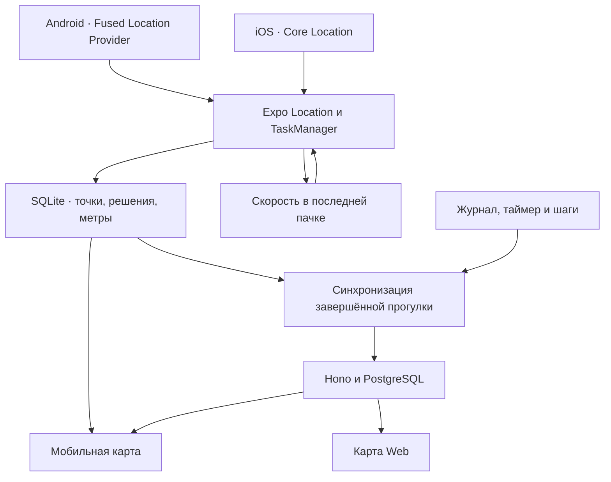
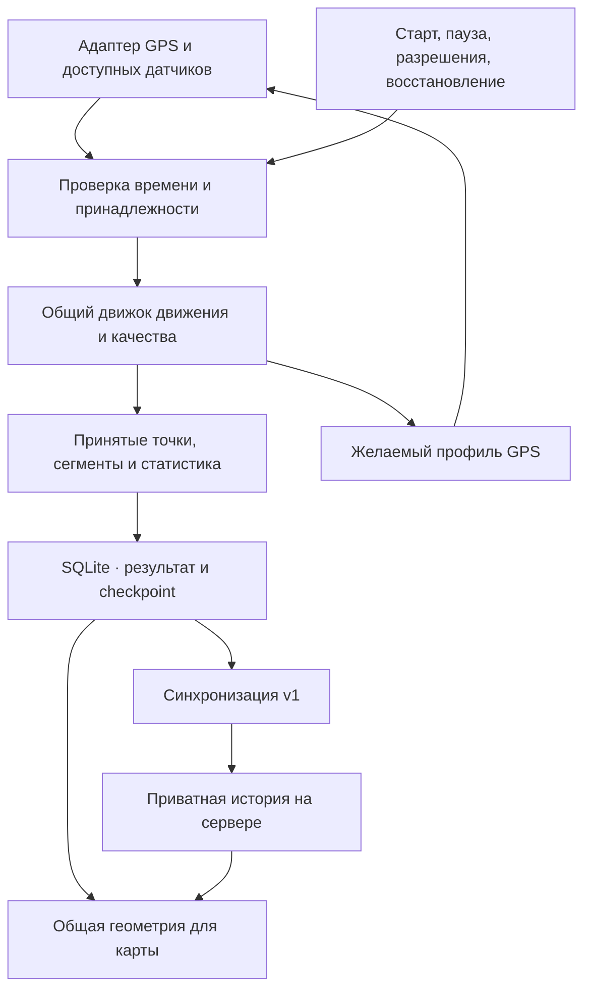

# GAFUS · Аудит и план рефакторинга GPS-трекинга прогулок

25 ноября 2026 · Решение для Android, iOS и Web · Статус — проект для реализации и независимой приёмки

**Первый релиз стоит посвятить трём вещам — отличать остановку от дрейфа, возобновлять запись без выдуманного пути и одинаково обрабатывать фоновые пачки на обоих телефонах.** Сегодня запись точек уже общая для Android и iOS. Зигзаги попадают и в статистику, и на карту. В контролируемом тесте с истинной дистанцией 160 м текущий фильтр начислил 187,95 м. Простое усреднение приблизило итог к 160 м, но увеличило ошибку положения в момент поворота. Поэтому приёмка должна одновременно оценивать метры, форму и задержку.

Предлагаю начать в существующем `@gafus/core-client`, сохранить один формат прогулок и сделать модуль независимым от Expo, MapLibre и сети. Первую версию можно спроектировать под текущие API и серверную схему. По решению владельца продукта все три целевые сборки, включая заменяемую Google Play 1.7.6, получают подписанные обновления через OTA GAFUS. Для каждой используется её зарегистрированный нативный профиль.

## 1. Границы и основания аудита

Исследованы рабочее дерево с `HEAD 8204d236d`, локальная ссылка `origin/main b76878a43`, релизные ветки iOS 1.7.5 и RuStore 1.7.5, нативные артефакты и установленные исходники Expo SDK 57. Между HEAD и указанным origin/main файлы прогулок совпали. У release-ветки iOS build 98 отличается, в частности, запуск фоновой задачи и восстановление разрешений. Ссылки на код ниже относятся к рабочему дереву. Самостоятельные измерения выполнены на синтетических координатах и существующих модульных тестах. Внешняя прогулка, замеры энергии и проверка доставки на устройства в этот аудит не входили.

## 2. Как маршрут проходит через систему сегодня

| Участок | Что происходит | Где проверить |
|---|---|---|
| Получение | Задача `gafus.dogwalk.gps.v1` регистрируется до Expo Router, работает без React. Из каждого измерения передаются широта, долгота, время измерения, горизонтальная точность и скорость. Курс в движок не передаётся. | [widget-entry](../../apps/mobile/widget-entry.ts#L1), [defineTask](../../apps/mobile/src/features/walk/walkGpsTask.ts#L33) |
| Частота и фон | Ходьба / медленно / стоянка запрашивают High / Balanced / Low и 5 / 10 / 25 м. На Android запрашиваются 4 / 8 / 20 с, работает location foreground service с уведомлением. На iOS уже заданы Fitness, автоматическая пауза, индикатор и отложенная фоновая выдача с интервалами 5 / 15 / 15 с и теми же расстояниями. Это условия запроса и доставки, фактические времена задаёт ОС. | [gpsTaskOptions](../../apps/mobile/src/features/walk/walkGpsTask.ts#L61), [WALK_GPS_INTERVALS](../../apps/mobile/src/features/walk/walkAdaptiveGps.ts#L52), [патч Android location FGS](../../patches/expo-location@57.0.23.patch) |
| Адаптация | Средняя максимум пяти годных скоростей **внутри одной пачки**, при условии точности ≤30 м и скорости 0–8 м/с. Границы 0,35 и 1,05 м/с, выдержка 12 / 20 / 45 с и минимум 25 с между переключениями. Логика меняет профиль получения данных. | [detectWalkGpsMode и advanceWalkGpsPolicy](../../apps/mobile/src/features/walk/walkAdaptiveGps.ts#L17), [adaptWalkGpsToMotion](../../apps/mobile/src/features/walk/walkGpsTask.ts#L93) |
| Точки и метры | Нормализация сортирует пачку. Фильтр проверяет координаты, время, точность 0–45 м, порядок, расстояние по гаверсинусу, предел 7 м/с с запасом на точность и два порога подавления дрейфа. Отсчёт ведётся от последней **принятой** точки. После разницы более 90 с хранилище начинает новый сегмент с нулевой дельтой. Эксклюзивная транзакция сохраняет строки всех представимых измерений, решения, дельты и итог сессии. | [classifyGpsSample](../../apps/mobile/src/features/walk/walkGpsMath.ts#L27), [normalizeGpsBatch](../../apps/mobile/src/features/walk/walkGpsMath.ts#L75), [persistGpsBatch](../../apps/mobile/src/features/walk/walkGpsStorage.ts#L129) |
| Шаги, скорость и таймер | Android использует собственный health FGS с аппаратным счётчиком либо детектором шагов. iOS запрашивает исторический счёт за текущий интервал через Pedometer. Шаги восстанавливаются относительно базы сегмента. GPS-скорость используется в фильтре и выборе профиля. Отдельного расчёта скорости прогулки в итоговом DTO нет. Дистанция равна `gpsMeters`, при отсутствии оценки используется `steps × 0,8 м`. Таймер исключает ручную паузу. | [DogWalkStepService](../../apps/mobile/native/android-walk/src/ru/gafus/app/walk/DogWalkStepService.java#L71), [экран прогулки](../../apps/mobile/app/%28main%29/walk.tsx#L234), [walkModel](../../apps/mobile/src/features/walk/walkModel.ts#L54), [выбор дистанции](../../apps/mobile/src/features/walk/walkModel.ts#L123), [toRemoteWalk](../../apps/mobile/src/features/walk/walkSync.ts#L25) |
| Офлайн и восстановление | Журнал, активная сессия, последний принятый fix, профиль, точки, курсор и маркеры удаления лежат в SQLite WAL. Пауза отключает запись до остановки нативной задачи. Повторный старт и возврат в foreground сверяют владельца, состояние прогулки, разрешения и регистрацию. Android-виджет запускает headless JS по нажатию, iOS складывает AppIntent-команды в App Group до исполнения основным процессом. Локальный маршрут переживает отсутствие интернета, доступность фоновых тайлов карты зависит от их загрузки. | [SQLite](../../apps/mobile/src/features/walk/walkGpsStorage.ts#L24), [startWalkGps](../../apps/mobile/src/features/walk/walkGpsTask.ts#L130), [foreground restore](../../apps/mobile/src/features/walk/WalkWidgetSessionSync.tsx#L67), [Android-виджет](../../apps/mobile/src/features/walk/androidWalkWidgetActions.ts#L87), [очередь iOS](../../apps/mobile/src/features/walk/iosWalkWidgetActions.ts#L132) |
| Синхронизация | После завершения телефон отправляет журнал пачками до 100, затем точки по 150 с курсором `seq`. Сервер принимает до 200, выдаёт страницы по 200, проверяет владельца и принимает повторы через составной ключ. Удаление оставляет tombstone, связанные точки удаляются каскадно. Среди отправляемых точек есть и отклонённые, если их поля проходят транспортную проверку. | [walkSync](../../apps/mobile/src/features/walk/walkSync.ts#L179), [строгая схема Hono](../../apps/api/src/routes/v1/walks.ts#L79), [tracking-server](../../packages/tracking-server/src/walksService.ts#L99), [модели Prisma](../../packages/prisma/schema.prisma#L4189) |
| Отображение | Мобильная карта читает локальные строки, для завершённой прогулки без локальных точек загружает серверные. Web читает API. Оба строят LineString из принятых координат по сегментам, с отдельными реализациями. В live-режиме также есть системный маркер MapLibre. | [WalkRouteMap](../../apps/mobile/src/features/walk/WalkRouteMap.tsx#L41), [toWalkGeoJson](../../apps/mobile/src/features/walk/walkRouteGeoJson.ts#L4), [WalkMap в Web](../../apps/web-vite/src/features/walks/WalksConnectedPage.tsx#L63) |

## 3. Где теряется точность и где есть риск регрессии

| Приоритет | Наблюдение и последствие | Доказательство в коде |
|---|---|---|
| P0 | Чередующиеся выбросы внутри заявленной погрешности проходят попарные пороги даже при нулевой GPS-скорости. Для медленной ходьбы те же пороги накапливают смещение и теряют хвост прогулки. Принятая координата сразу становится вершиной линии и добавляет метры. | [classifyGpsSample, строки 50–69](../../apps/mobile/src/features/walk/walkGpsMath.ts#L50), [фиксация результата](../../apps/mobile/src/features/walk/walkGpsStorage.ts#L166) |
| P0 | Время последнего принятого перемещения одновременно служит признаком живого сигнала. Непрерывная стоянка порождает лишние сегменты. При более короткой потере сигнала первая удалённая точка может начислить расстояние по прямой, если укладывается в предел скорости. | [граница 90 с](../../apps/mobile/src/features/walk/walkGpsMath.ts#L45), [условие открытия сегмента](../../apps/mobile/src/features/walk/walkGpsStorage.ts#L157), [обновление времени](../../apps/mobile/src/features/walk/walkGpsStorage.ts#L184) |
| P0 | Пачка после паузы, новой прогулки или смены владельца привязывается к сессии, активной в момент записи. У сессии нет границы времени начала текущего сегмента. Первую точку проверяют только на положительный timestamp и прочие базовые признаки. Это риск ошибочной принадлежности старого fix. Сортировка действует лишь внутри одной пачки. | [activateGpsSession](../../apps/mobile/src/features/walk/walkGpsStorage.ts#L74), [выбор активной сессии](../../apps/mobile/src/features/walk/walkGpsStorage.ts#L134), [первая точка](../../apps/mobile/src/features/walk/walkGpsMath.ts#L27) |
| P1 | Профиль меняется по последней пачке после записи в SQLite. Размер пачки влияет на результат, адаптация получает исходный массив до нормализации. Вход в экономный профиль может замедлить восстановление — для следующего решения нужны новые точки с точностью ≤30 м. На iOS Balanced/Low в установленном Expo запрашивают 100 м / 1 км, на Android эти два уровня соответствуют одному balanced priority. Частоту реального проявления надо измерить. | [вызов адаптации](../../apps/mobile/src/features/walk/walkGpsTask.ts#L41), [выбор режима](../../apps/mobile/src/features/walk/walkAdaptiveGps.ts#L18), [настройки ОС](../../apps/mobile/src/features/walk/walkGpsTask.ts#L61) |
| P1 | `gpsWalkMeters` возвращает `null`, пока нет положительной дельты. Подтверждённая неподвижность и отсутствие координат для потребителя неразличимы. На мобильной карточке признак GPS берётся из `gpsMeters`, на Web подпись маршрута — из `gpsEnabled`. При выгрузке `estimatedMeters` для прогулки с GPS дублирует GPS-итог. | [gpsWalkMeters](../../apps/mobile/src/features/walk/walkGpsStorage.ts#L209), [мобильная карточка](../../apps/mobile/src/features/walk/walkHistoryFormat.ts#L37), [Web](../../apps/web-vite/src/features/walks/WalksConnectedPage.tsx#L229), [DTO](../../apps/mobile/src/features/walk/walkSync.ts#L25) |
| P1 | Live-карта каждые 5 с перечитывает первые 10 000 строк и заново собирает геометрию. Отдельный опрос читает метры. История на обоих клиентах ограничена 50 страницами по 200. На 10 001-й строке возможна потеря видимого конца прогулки. Геометрия, проверки и подсчёт точек продублированы. | [allGpsPoints](../../apps/mobile/src/features/walk/walkGpsStorage.ts#L275), [refresh и polling](../../apps/mobile/src/features/walk/WalkRouteMap.tsx#L41), [опрос метров](../../apps/mobile/app/%28main%29/walk.tsx#L486), [Web-пагинация](../../apps/web-vite/src/features/walks/WalksConnectedPage.tsx#L36) |
| P1 | Каждая представимая точка получает новую строку и `seq`, включая повторные доставки и отклонения. В действующем пути хранения и sync нет срока жизни для исходных отказов. Добавление окон фильтра с координатами потребует также чистить новый checkpoint при удалении прогулки. Сейчас удаление точек явно перечисляет таблицы. | [insert raw](../../apps/mobile/src/features/walk/walkGpsStorage.ts#L166), [удаление](../../apps/mobile/src/features/walk/walkGpsStorage.ts#L302), [фильтр отправки](../../apps/mobile/src/features/walk/walkSync.ts#L187), [данные сервера](../../packages/tracking-server/src/walksService.ts#L107) |

### Контрольные измерения текущего кода

Запущены существующие `classifyGpsSample`, `normalizeGpsBatch` и функции политики на синтетических данных. Для агрегирования воспроизведено условие сегментации из `persistGpsBatch`. SQLite, датчики и планировщик ОС в этом опыте не участвовали. Во всех строках с периодической записью шаг времени — 4 с, точность — 8 м, плоское смещение переведено в угловые координаты на экваторе с радиусом из `haversineMeters`.

| Вход и воспроизведение | Истина | Результат текущей версии |
|---|---:|---|
| 151 точка за 10 мин, позиция попеременно −7,5 и +7,5 м, speed=0 | 0 м | 2 250 м, приняты все 151. Это намеренно тяжёлый тест, по нему нельзя судить о среднем дрейфе телефона |
| 151 одинаковая точка, speed=0 | 0 м, непрерывный сигнал | 0 м, 7 сегментов |
| 151 точка на прямой через 1,2 м, speed=0,3 м/с | 180 м | 169,2 м, приняты 14 точек |
| Измерения (секунда, метр) = (0,0), (4,5), (64,85), скорость неизвестна | Последние 60 с без наблюдений | 85 м в одном сегменте. Форма пути во время разрыва неизвестна |
| (0,0), (4,8), (104,88), скорость неизвестна | Разрыв 100 с | 8 м, 2 сегмента. Положительный контроль текущей защиты |
| 16 одинаковых точек с нулевой скоростью за 60 с, подать отдельно и одной пачкой | Одна физическая последовательность | По одной — `stationary`, одной пачкой — `walking` |

## 4. Алгоритмы и применимость исследований

| Подход | Решение для GAFUS и основание |
|---|---|
| Проверка точности, времени и выбросов | Сохранить фильтр невалидных чисел и координат. Использовать горизонтальную точность как оценку неопределённости. Присваивать низкий вес пограничным фиксациям, отбрасывать явно недостоверные. Проверять смещение в метрах относительно времени, погрешности и последних согласованных точек. Скорость, ускорение и курс — подтверждающие признаки. Отдельно разрешить реальный бег и разворот. Измерительная ошибка способна систематически увеличивать сумму GPS-отрезков. [Android Location](https://developer.android.com/reference/android/location/Location#getAccuracy()), [Apple horizontalAccuracy](https://developer.apple.com/documentation/corelocation/cllocation/horizontalaccuracy), [Ranacher et al.](https://arxiv.org/abs/1504.04504) |
| Остановки и короткие перемещения | Первый кандидат — окно по времени, устойчивый центр и радиус разброса с учётом точности, раздельные условия входа и выхода. Проверять накопленное **направленное** смещение, скорость и согласованные шаги. Возобновление подтвердить несколькими наблюдениями, сохраняя начало движения в коротком буфере. Ручная пауза и вычитание времени остаются отдельными действиями пользователя. У Strava также документированы отдельные понятия движущегося времени и измерения дистанции. [Strava, время и скорость](https://support.strava.com/en-us/articles/15401804-moving-time-speed-and-pace-calculations), [Strava, дистанция](https://support.strava.com/en-us/articles/15401893-how-distance-is-calculated) |
| Медиана / EMA / адаптивный Калман | Контроль — хорошие принятые точки без сглаживания. Сравнить короткую медиану для одиночных выбросов, причинное экспоненциальное сглаживание (EMA) и двумерную модель Калмана с положением и скоростью в локальных метрах. Окно и EMA дают задержку. Для Калмана пересчитывать переход по фактическому Δt, оценку шума измерения R по accuracy, шум модели Q по подтверждённому манёвру. Проверять остаток измерения, ослаблять инерцию на поворотах, сбрасывать состояние на разрывах. Далёкие прогнозы фильтра не становятся маршрутными точками. [Welch и Bishop, модель и ковариации](https://www.cs.utexas.edu/~pstone/Courses/393Rfall15/readings/Welch%2BBishop-TR-95.pdf) |
| Ramer–Douglas–Peucker (RDP) | После расчёта метров — метрическое упрощение отдельно внутри сегмента с фиксированными концами, вершинами подтверждённых поворотов и разворотов. Сравнить с радиальным прореживанием (дешевле, может потерять разворот) и полным отображением. Допуски 1 / 2 / 3 м проверить на фиксированном масштабе. В live упрощать закрытые фрагменты и держать короткий точный хвост. На истории использовать ту же функцию с тем же профилем. [Douglas и Peucker, оригинальная работа](https://doi.org/10.3138/FM57-6770-U75U-7727) |
| Привязка к графу | Основной путь восстанавливать на устройстве, включая лес, газон, дворы и неофициальные тропы. У Яндекса `DrivingRouter.matchRoute` документирован для внешнего автомобильного маршрута и может корректировать точки в пешеходных зонах. HMM map matching зависит от полноты графа. Привязку отложить. Возвращаться к ней только как к добровольному варианту отображения по пешеходному графу с оценкой неоднозначности, возможностью оставить исходную линию и отдельным офлайн-тестом. [Яндекс MapKit](https://yandex.com/maps-api/docs/mapkit/android/generated/tutorials/map_routing.html), [NaviKit](https://yandex.com/maps-api/products/navikit), [Newson и Krumm](https://www.microsoft.com/en-us/research/publication/hidden-markov-map-matching-noise-sparseness/) |
| Частота записи | Явно различать частоту измерений, доставку пачек и количество вершин на карте. У Garmin опубликован режим записи с переменным интервалом. Android описывает энергетическую цену высокой точности и частых пробуждений. В GAFUS уменьшать активность при устойчивой стоянке только после измерения задержки возвращения к ходьбе. [Garmin](https://support.garmin.com/en-PH/?faq=fs1RImTxZv0EvzqbSn5ZH8), [Android — батарея](https://developer.android.com/develop/sensors-and-location/location/battery), [Fused LocationRequest](https://developers.google.com/android/reference/com/google/android/gms/location/LocationRequest) |
| Спортивные платформы | Apple описывает маршрут тренировки как последовательность CLLocation и публикует рекомендации для записи. Google Fit раздельно определяет образцы местоположения и дистанцию. Это ориентиры для модели данных. Внутренние коэффициенты и алгоритмы приложений Apple Fitness, Garmin, Яндекса и Google Fit из этих контрактов вывести нельзя. [Apple — запись маршрута](https://developer.apple.com/documentation/healthkit/creating-a-workout-route), [Google Fit — location data types](https://developers.google.com/fit/datatypes/location) |

**Сравнение на известной геометрии.** Квадрат 40 × 40 м, 41 измерение через 4 с, 1 м/с, полный периметр 160 м. Во втором прогоне к координатам с индексом i добавлены `3·sin(1,7i)` и `3·sin(1,2i)` метров. Вход v1 — accuracy=6 м. В таблице стандартные сглаживатели применены прямо к одним измерениям, в обход классификатора, чтобы измерить вклад одного сглаживания. EMA с весом нового измерения 0,5. Контрольный Калман по каждой оси использует постоянную скорость, σ измерений 4 м, σ ускорения 0,6 м/с², начальную скорость 0, P=diag(16,4), интервальную модель постоянного случайного ускорения. Это вычислительный опыт, без изменения исходников.

| Метод | Длина без шума | Длина с шумом | Среднеквадратичная ошибка позиции с шумом | Макс. ошибка в момент трёх поворотов с шумом |
|---|---:|---:|---:|---:|
| Входные точки | 160,00 м | 201,21 м | 2,98 м | 3,59 м |
| Текущий GAFUS | 160,00 м | 187,95 м | — | — |
| EMA | 147,12 м | 156,37 м | 3,94 м | 5,68 м |
| Контрольный Калман | 160,16 м | 197,21 м | 2,87 м | 3,66 м |

**Выбор для первого этапа** — контроль качества, модель остановок и разрывов, затем сравнение сглаживателей с этим базовым вариантом. EMA здесь дала хорошую итоговую дистанцию ценой срезанных углов. Проверенная настройка Калмана проиграла v1 по ошибке длины зашумлённого квадрата. Оснований включать какой-либо из этих фильтров по умолчанию пока нет. Адаптивный вариант проходит в релиз только при выигрыше на отложенных записях по критериям раздела 9.

## 5. Целевая архитектура и жизненный цикл

**Контракт.** Чистая функция принимает версию конфигурации, предыдущее состояние и упорядоченное событие. События — измерение, достоверный интервал шагов, изменение доступности GPS, старт, ручная пауза, возобновление и завершение. Ядро возвращает следующий checkpoint, принятые координаты с сегментами и дельтами, статистику и желаемый профиль получения GPS. Время измерения, поступления и управляющих действий передаётся явно. Показатель свежести экрана вычисляется отдельно от исторической геометрии. Один и тот же поток с теми же событиями и конфигурацией должен давать одинаковые метрические результаты при разном разбиении на пачки.

| Представление | Содержание и срок жизни | Потребитель |
|---|---|---|
| Raw | Координаты и исходные времена, accuracy, необязательные speed/course, качество сопутствующего датчика. В обычном режиме — оперативное ограниченное окно, в checkpoint только минимальный незавершённый хвост. | Нормализация и восстановление |
| Validated | Проверенное наблюдение, уровень доверия, причина решения. Плохая или устаревшая точка может сообщить о проблеме с сигналом. Постоянно хранить достаточно счётчика причин. | Определение движения и качества |
| Filtered | Канонические принятые точки с монотонным seq, segment, измеренным временем и подтверждённой дельтой. Начало сегмента даёт 0 м. | SQLite, существующий track API, история |
| Display | GeoJSON по сегментам из канонических точек, прореженный в метрах, с защищёнными вершинами. Производное представление, которое можно восстановить. Одиночная точка даёт место на карте без линии. | MapLibre на Web, Android и iOS |
| Statistics | Сумма подтверждённых дельт до RDP, статус достаточности GPS, время прогулки за вычетом ручных пауз, шаги и статус их полноты. Для динамики — скорость на коротком временном окне движения, для разрыва — неизвестна. Среднюю считать только при явно выбранном знаменателе. | Экран, история, виджеты, sync |

### Правила переходов

1. **Приём.** Разделить время последнего измерения, последнего годного наблюдения и последнего подтверждённого перемещения. Сверять epoch активной сессии и `measuredAt` с границами владельца, прогулки и ручного сегмента. Старые данные от предыдущей сессии изолировать до записи. Учесть одинаковые timestamp с различными координатами: детерминированное предпочтение более качественного fix, затем стабильное правило разрешения равенства. Ограниченный буфер опоздания и watermark действуют между пачками, дубликаты и данные до уже зафиксированного watermark не увеличивают distance/seq. Финализация хвоста выполняется один раз. Проверять аномалии часового времени, исключать «якорь» из будущего. Отложенная пачка с корректными временами внутри сессии сохраняет историю. Live-маркер показывает только свежую позицию.
2. **Остановка.** Вести состояния «движение», «возможная остановка», «стоит» и «возобновляет движение». Кластер в пределах погрешности и малое согласованное смещение на временном окне держат позицию около якоря. Для выхода требовать устойчивого сдвига, согласованного курса либо шагов в соответствующем интервале. Движение с неизвестной скоростью, короткие выходы из кластера и шаги на месте должны быть отдельными тестами. Подтверждённая остановка даёт 0 м и сохраняет продолжительность прогулки. Буфер начала движения позволяет учесть первые метры после подтверждения.
3. **Потеря и возврат.** Потерянный сигнал описывает качество наблюдения, ручная пауза — намерение пользователя. Явное отключение геолокации, отзыв разрешения, неизвестная непрослеженная область, длительный разрыв годных измерений относительно ожидаемой частоты или нестыкуемая серия переводят сегмент в ожидание. Граница зависит от режима и качества. Непрерывный поток хороших неподвижных измерений поддерживает текущий сегмент. Один выброс при продолжающемся хорошем треке оставляет сегмент живым. При восстановлении дождаться согласованных фиксаций, первую точку нового сегмента записать с 0 м, на карте оставить разрыв. Если сигнала не было, статистика может быть неполной. Шаговую оценку показывать отдельно. Серия под мостом, внутри здания и в городском каньоне проверяется по времени измерений, включая отложенную доставку.
4. **Статистика.** Дистанцию считать по фильтрованным подтверждённым координатам внутри сегмента, суммировать до округления. Подтверждённая GPS-стоянка = `gpsMeters: 0`, недостаточно годных измерений = `null`. Сохранить текущий fallback по шагам, связь с таймером и контракт `estimatedMeters` для старых клиентов. Для решения о движении использовать устойчивую оценку скорости по изменению координат и времени, при доступности учитывать нативную скорость. Во время паузы и разрыва не добавлять прогнозируемые метры. Публичную метрику скорости для базового релиза добавлять не требуется.
5. **Атомарность.** Версию движка и параметров закреплять на старте новой прогулки. В одной SQLite-транзакции сохранить согласованные точки, high-water mark, segment, статистику, состояние окна/фильтра и следующий seq. Политику ОС применяет адаптер после commit и проверки той же активной epoch. Ошибка перенастройки допускает повтор и сохраняет последнюю рабочую подписку. Повтор после сбоя между commit и callback не удваивает время, метры или строки.
6. **Пауза, finish и перезапуск.** Обработать уже поступившие измерения до границы остановки, зафиксировать хвост, закрыть сегмент до выключения датчиков. Точки, доставленные после закрытия, не переходят в следующий сегмент. После убийства процесса читать checkpoint, сверять регистрацию задачи и разрешения, при неизвестной непрерывности открывать новый сегмент. При конкуренции экрана, виджета и headless сохранять единственного владельца записи. Восстановление не предполагает, что ОС продолжала поставлять геопозицию после принудительной остановки.

### Приватность

Для новых прогулок сохранять и синхронизировать только принятый канонический маршрут. Передавать его на тот же защищённый endpoint с прежними полями, исключить отправку отклонённых точек и сырых окон нового движка. Счётчики качества — причины, числа, длительности и интервалы. Координатам и сериализованным входам нет места в обычных логах, аналитике и crash reports. Исторические записи остаются доступны через прежние права и пользовательское удаление.

Для полевой диагностики предложен добровольный локальный режим тестера: одна отмеченная прогулка, явное завершение и удаление, черновой TTL 24 часа, проверка срока при старте/возвращении приложения. Вне QA сырые координаты после обработки живут только до закрытия окна. Диагностические записи хранить отдельно от очереди sync, при удалении прогулки/аккаунта чистить и связанное состояние, на logout закрывать доступ и уничтожать временный сырой хвост по правилам восстановления. Для воспроизводимых fixtures применять синтетику или перенос траектории в локальную систему без исходной геопривязки и абсолютных времён. Узнаваемая форма реальной прогулки всё равно требует контролируемого доступа. Основание для проектирования удаления и owner-only доступа — [локальный tombstone](../../apps/mobile/src/features/walk/walkGpsStorage.ts#L301), [серверное удаление](../../packages/tracking-server/src/walksService.ts#L143), [заголовки API](../../apps/api/src/routes/v1/walks.ts#L5).

## 6. Пакеты, файлы и границы ответственности

**Место общего движка — `packages/core-client/src/walk-tracking/` с публичным импортом `@gafus/core-client/walk-tracking`.** Этот пакет уже зависит только от клиентски допустимого окружения и подключён к Mobile и Web. В GAFUS добавление нового workspace-пакета как зависимости приложения обычно меняет mobile/package.json и pnpm-lock.yaml. Оба файла, вместе с Metro-конфигом, входят в нативный fingerprint выпущенных сборок. Подпакет с отдельным export в уже подключённом core-client позволяет иметь единственную реализацию и проверять штатный fingerprint на релизной ветке. Это также соответствует действующему прецеденту общего клиентского модуля. [Mobile](../../apps/mobile/package.json#L49), [Web](../../apps/web-vite/package.json#L21), [exports core-client](../../packages/core-client/package.json#L7), [расчёт fingerprint](../../apps/mobile/scripts/native-source-fingerprint.mjs#L7), [архитектурный план](gafus-architecture-refactoring-plan-20261118.md#L90)

| Будущее изменение | Файлы и результат |
|---|---|
| Чистый TS | В указанном каталоге `types.ts` — входы, события, снимок и выход, `engine.ts` — функция перехода и правила сегментов, `motion.ts` — качество, движение, остановки, `geometry.ts` — расстояния и упрощение, `index.ts` — узкий публичный API. Сглаживатель выделять в отдельный файл при выборе по replay. В [package.json общего пакета](../../packages/core-client/package.json) добавить export и при необходимости typesVersions по существующему образцу. Импорты RN, Expo, Prisma, карты, часы и сеть в математическом модуле исключены. |
| Адаптер записи и хранения | [walkGpsTask](../../apps/mobile/src/features/walk/walkGpsTask.ts), [walkGpsStorage](../../apps/mobile/src/features/walk/walkGpsStorage.ts), [walkAdaptiveGps](../../apps/mobile/src/features/walk/walkAdaptiveGps.ts), [walkGpsMath](../../apps/mobile/src/features/walk/walkGpsMath.ts). Перенести геометрию и правила в общий модуль, оставить v1 для активных старых сессий/восстановления. Сохранить имя задачи, SQLite-файл, WAL и последовательную регистрацию. Адаптер передаёт разрешения, timestamp и доступные признаки. Хранение выдаёт те же принятые точки читателю и sync. |
| Экран, шаги и действия | [walk.tsx](../../apps/mobile/app/%28main%29/walk.tsx), [WalkWidgetSessionSync](../../apps/mobile/src/features/walk/WalkWidgetSessionSync.tsx), [androidWalkWidgetActions](../../apps/mobile/src/features/walk/androidWalkWidgetActions.ts), [iosWalkWidgetActions](../../apps/mobile/src/features/walk/iosWalkWidgetActions.ts), [walkModel](../../apps/mobile/src/features/walk/walkModel.ts), [walkHistoryFormat](../../apps/mobile/src/features/walk/walkHistoryFormat.ts). Свести команды к одной операции перехода GPS-сессии. Сохранить таймер, countdown/напоминания, шаговый fallback, постановку уведомлений, snapshot и очередь действий виджетов. |
| Карты и длинная история | [WalkRouteMap](../../apps/mobile/src/features/walk/WalkRouteMap.tsx), [walkRouteGeoJson](../../apps/mobile/src/features/walk/walkRouteGeoJson.ts), [история Mobile](../../apps/mobile/app/%28main%29/walk-route.tsx), [WalksConnectedPage](../../apps/web-vite/src/features/walks/WalksConnectedPage.tsx). Общий построитель линий и источник дистанции. Различать системное текущее положение, записанную линию и последний подтверждённый fix. Рендерить последнюю вершину длинного маршрута, отменять чтение по смене прогулки/аккаунта. Историческим трекам сохранять исходные сегменты, можно применить RDP на чтении с теми же правилами. |
| Транспорт и история | [walkSync](../../apps/mobile/src/features/walk/walkSync.ts), [контракт Hono](../../apps/api/src/routes/v1/walks.ts#L79), [публичная точка входа tracking-server](../../packages/tracking-server/src/walks.ts), [модели](../../packages/prisma/schema.prisma#L4189). Для первой версии расширить контрактные тесты, адаптировать запись новых прогулок к существующему DTO. Сервер продолжает хранить клиентский результат, без повторной фильтрации. |

### Android, iOS и подбор настроек

| Сигнал или настройка | Android | iOS | Как использовать |
|---|---|---|---|
| GPS | Fused Location Provider, timeInterval и distanceInterval, точность, location FGS и уведомление | Core Location, distanceFilter, Fitness, auto-pause, background deferred delivery | Начать A/B с текущего профиля. Для движения сравнить Android 4 с / 5 м с 3 с / 3 м и 2 с / 2 м, iOS 5 м против 2–3 м при Fitness. На iOS нет эквивалента фиксированного timeInterval. Сохранять быстрый режим при поиске движения, понижать частоту только при устойчивой стоянке. |
| Качество, скорость, курс | В установленном expo-location Android адаптер экспортирует `location.speed` и `bearing` без отдельных признаков `hasSpeed/hasBearing` | Core Location экспортирует speed, course и horizontalAccuracy, возможны недоступные значения | Отрицательные/нечисловые значения нормализовать в unknown, нулевая скорость сама по себе не доказывает остановку. Начать с диапазонов точности ≤10, 10–25 и >25 м, сравнить со старой границей 45 м. Курс использовать при достаточном перемещении и доверии. |
| Шаги | Существующий счётчик/детектор, health FGS, snapshot владельца | Pedometer с историческим запросом за интервал при доступе Motion & Fitness | Использовать только наблюдаемые интервалы и давность. Отсутствие свежего счётчика при заблокированном экране означает unknown. При недоступности датчика движок GPS самостоятельно различает движение и стоянку. |
| Activity recognition | SDK 57 предоставляет foreground API и использует разрешение на физическую активность | Через Expo доступен foreground API на базе Core Motion | В статическом осмотре у архивной iOS 98 и Android-артефактов обнаружены символы motion activity, шагомера, акселерометра и гироскопа. Доступность конкретного датчика и разрешения проверять на устройстве. Начать с GPS и имеющихся шагов. Активность пробовать отдельным A/B только при выданном разрешении. |
| Акселерометр, гироскоп | Модули есть в проверенных Android-бинарниках | Модули есть в проверенном архиве iOS | Не вводить постоянную высокочастотную подписку в первый релиз. Для спорной медленной ходьбы позднее сравнить краткие окна в foreground. Постоянно работающая фоновая IMU и инерциальное восстановление пути требуют отдельного обоснования и оценки native lifetime. |

Время удержания позиции и момент экономии батареи — разные параметры. Сравнить окно подтверждения остановки 5–10 и 10–20 с при частых измерениях, отдельно подобрать выдержку перед снижением качества и быстрый выход при возобновлении. В iOS-реализации Expo 57 фоновая выдача проверяет одновременно пройденное расстояние и интервал, foreground передаёт сразу. Android при перенастройке подписки выполняет stop/start location updates. Проверить, сколько пригодных точек теряется при переключении. Применять задержку между переключениями, группировать пожелания движка на уровне адаптера и сохранять доступность уведомлений. Оценивать auto-pause iOS on/off в парных испытаниях. На приближённой геолокации или при отказе продолжать таймер/шаги и показывать состояние сигнала. [Expo Location SDK 57](https://docs.expo.dev/versions/v57.0.0/sdk/location/), [Expo Pedometer](https://docs.expo.dev/versions/v57.0.0/sdk/pedometer/), [Apple Fitness activity type](https://developer.apple.com/documentation/corelocation/clactivitytype/fitness)

Нативные детали сверены с установленным `expo-location@57.0.23`. В Android-исходниках это `LocationHelpers.kt` (mapAccuracyToPriority), `records/LocationResults.kt` (LocationObjectCoords) и `taskConsumers/LocationTaskConsumer.kt` (setOptions). На iOS — `EXLocation.m` (преобразование accuracy) и `TaskConsumers/EXLocationTaskConsumer.m` (setOptions, shouldReportDeferredLocations). Ограничение подписки активности режимом foreground прямо указано в `src/Location.ts` у watchMotionActivityAsync. Для воспроизведения использовать версию зависимости из [мобильного пакета](../../apps/mobile/package.json#L84) и [lockfile репозитория](../../pnpm-lock.yaml).

## 7. Данные, совместимость и доставка OTA

**Миграция первой версии локальная, добавочная и отложенная.** Создать в существующей SQLite таблицу состояния по (ownerId, walkId) с версией схемы, версией движка и параметров, границами epoch, временным окном, последней принятой позицией, статусом GPS и статистикой. Минимальный checkpoint согласован с существующими gps_sessions/gps_points. Версионировать сериализацию, проверять её при восстановлении. При неизвестной или повреждённой версии сохранять подтверждённые метры, начинать следующий сегмент через совместимый обработчик. Старый журнал без версии и уже идущая во время обновления прогулка заканчиваются на v1. Следующая прогулка выбирает движок один раз. Действующие reader, tombstone и cursor должны работать при обоих форматах записи.

**Серверный контракт.** Для новых прогулок v2 передаёт канонические `latitude/longitude`, `segment`, `deltaMeters`, `accepted=true`, существующие `reason=first|ok` и публичные поля v1. Точность относится к исходному измерению, а не означает вычисленную точность фильтра. Использовать существующие ограничения длины пачки, диапазона значений, максимальной дельты и seq. Новые причины решения и сырой вход оставлять внутри устройства. Старые неподтверждённые строки v1 продолжают выгружаться по старому курсору, старые клиенты читают новые принятые вершины как обычный маршрут. Суммарная дистанция хранится независимо от геометрии показа. Случаи `gpsMeters=null`, `0`, положительное значение и частичный GPS прогнать в обе стороны. Добавление полей в strict DTO потребует совместимого изменения API до клиентов. Серверное поле версии/покрытия и отдельный компактный endpoint для геометрии отложить до появления потребителя или измеренного предела по размеру. Массовый пересчёт, перезапись seq или удаление ранее сохранённых прогулок для перехода не нужны.

| Целевая сборка | Основание и проверка допуска | Канал по согласованному плану |
|---|---|---|
| iOS App Store 1.7.5 | В локальном Xcode-архиве 98 и IPA сборки 101 проверены версия, background location и наличие модулей. В архивах 98 и 101 — production, runtime 1.7.5 и сертификат GAFUS. На этапе выпуска выбрать фактические подтверждённые App Store-профили. Номер локальной IPA не определяет активную сборку в магазине. Учесть расхождение адаптера ветки 98 с main. | Подписанный OTA GAFUS для каждого нужного нативного профиля iOS |
| Android RuStore 1.7.5 | В локальном подписанном APK 17506 по манифесту проверены 1.7.5, location/health FGS, background location, activity recognition, runtime и GAFUS update URL. В DEX найдены location, task manager, SQLite, датчики и MapLibre. | Подписанный OTA GAFUS для профиля RuStore 17506 |
| Android Google Play 1.7.6 | Для GPS использован локальный образ 17602 для проверки состава датчиков и разрешений. Целевой профиль — заменяющая сборка 1.7.6, настроенная на OTA GAFUS. При её регистрации использовать фактические build code и fingerprint. | Подписанный OTA GAFUS для профиля Google Play 1.7.6 |

**Через OTA:** чистый TS и параметры, уже поддержанные существующим SDK, нормализация, локальная SQLite-схема через существующий модуль, построение GeoJSON, UI, чтение принятых точек, упаковка sync. **Через обычный Web/API релиз:** общий вывод истории в браузере и возможное будущее расширение DTO. **Через новый нативный бинарник:** добавление библиотеки/моста, новые permissions/entitlements, изменение FGS-типа, AppIntent/WidgetKit, патча Expo, обработчика датчиков на Java/Swift или фоновых возможностей ОС. Первая версия GPS укладывается в JS/SQLite при совпадении нативного профиля. Проверка доставки включает сборку общего пакета **до** Metro export на каждой релизной ветке, штатную сверку fingerprint, подписи, канала, runtime и release ID, затем запуск офлайн. [Проверка fingerprint](../../apps/mobile/scripts/native-source-fingerprint.mjs#L24), [production workflow](../../.github/workflows/gafus-self-hosted-ota-production.yml), [выбор совместимого набора](../../packages/mobile-ota-server/src/version-selection.ts#L45), [Expo runtime versions](https://docs.expo.dev/eas-update/runtime-versions/)

## 8. Поэтапная реализация

| Этап | Зависимость | Что делает разработчик | Условие завершения |
|---|---|---|---|
| 0. Воспроизводимая база | Нет | Зафиксировать v1 и конфигурацию по сборкам. Подготовить формат replay, синтетические эталоны и согласованные полевые записи. Снять baseline батареи, положения, задержки и размера. До подбора параметров разделить маршруты на тренировочные и отложенные. | Отдельный запуск воспроизводит цифры раздела 3. В отчёте есть результаты по двум устройствам, открытой местности и трудным условиям. |
| 1. Общее ядро и геометрия | 0 | Извлечь существующие расчёты без изменения поведения, добавить публичный export, перевести обе карты на единый построитель сегментов. Сначала прогнать существующие точки вызова и golden v1. | Метры и точки текущего алгоритма совпадают с эталонами до согласованного округления. Старый API и обе карты читают одни и те же сохранённые треки. |
| 2. Корректность записи | 1 | Ввести события сессии, устойчивую дедупликацию, checkpoint, явные состояния качества, ручной паузы и правила разрыва. Сохранить v1 reader/writer для идущих старых прогулок. | Гонки pause/resume/logout, crash/retry после commit, поздние пачки и перестановка границ callback проходят. Между сегментами 0 ложных рёбер и метров. |
| 3. Остановки, ходьба и повороты | 2 | Реализовать базовый вариант «окно + гистерезис». На тех же входах сравнить его с EMA, устойчивой медианой и адаптивным Калманом. Выбрать простейший вариант, который проходит полевые и отложенные критерии. | Версионированные параметры и таблица результатов по каждому классу маршрутов. Медленные перемещения, бег и развороты проходят независимо от среднего по выборке. |
| 4. Live-карта, хранение, транспорт | 2, финальная проверка после 3 | Инкрементальное чтение по seq, один снимок состояния для карты/метрик, RDP в локальных метрах, общий формат статистики, выгрузка только канонических данных для новых сессий. Обрабатывать страницы до конца с контролем продвижения курсора, отменой, лимитом памяти и явным состоянием частичной загрузки при ошибке. | Длинная прогулка показывает последний участок во всех клиентах. Перезапуск, офлайн/повторная отправка и удаление сохраняют итог. Проверены совместимость и очистка новых локальных данных. |
| 5. Адаптеры и энергопотребление | 3, 4 | Проверить начальные параметры на Samsung и iPhone, настроить устойчивые профили записи. Дополнительные данные об активности подключать только при измеримом выигрыше и доступных разрешениях. | Парные замеры подтверждают бюджет батареи, виджеты/уведомления и шаги. Экран, блокировка и фон отрабатывают по матрице. |
| 6. Проверка доставки и постепенное включение | 0–5 | Закрепить выбранное поведение в main и совместимых release-ветках, подготовить пакеты и версию восстановления. Проверить на тестерах каждого из трёх профилей. | Независимый QA подтвердил качество, миграцию, фактическую установку и восстановление. После этого можно расширять аудиторию. |

## 9. Измеримые критерии

Значения ниже — предлагаемые пороги первого релиза. Измерены только результаты разделов 3–4. Уточнить полевые бюджеты после этапа 0 **до** просмотра результатов отложенной выборки. Считать по каждому телефону и типу среды, приводить число наблюдений, медиану, p95 и худшие случаи. Для ошибки дистанции показывать и знак. Для коротких маршрутов приводить метры. Для участка без наблюдений отдельно сообщать покрытие и разницу с полной истинной длиной, чтобы фильтр не получил хороший балл простым удалением данных.

| Метрика | Проверка и предлагаемый порог |
|---|---|
| Дистанция | На размеченном маршруте ≥500 м под открытым небом медианная абсолютная относительная ошибка ≤3%, p95 ≤5%. На медленной ходьбе 0,3–0,6 м/с ошибка ≤5% на контролируемой прямой ≥100 м. На сложных маршрутах целиться в снижение медианной абсолютной ошибки ≥20% относительно v1, без ухудшения покрытия. Делить результаты по лесу и городской застройке. |
| Стоянка и ложные скачки | На 10 мин неподвижности цель ≤5 м на открытом месте, ≤10 м в сложной среде (p95 повторов). На синтетике с заведомо неподвижным телефоном после подтверждения стоянки прирост 0. На размеченных вставках скачков 50–300 м и на границах pause/gap — 0 ложных соединений. Считать также пропущенные реальные перемещения и ложные остановки на км. |
| Положение и повороты | Сравнить поперечное отклонение от измеренной линии и ошибку в синхронный момент времени. Для открытой местности цель p95 поперечной ошибки ≤8 м и отсутствие ухудшения против v1. У поворотов 90°/180° сохранить порядок и ветви, отступ от вершины ≤5 м на качественном replay, включая возврат по своим следам. |
| Задержка и восстановление | В foreground при хороших данных p95 от измерения до отображения подтверждённой позиции ≤6 с. Отдельно логировать время измерение→доставка и доставка→кадр. Остановку обнаруживать за ≤10 с в медиане и ≤15 с p95 при поступающих хороших точках. После восстановления — первый пригодный сегмент за ≤2–3 хороших измерения (цель ≤10 с на активном профиле). Время вынужденной паузы ОС учитывать отдельно. |
| Детерминизм и статистика | Для одинаковой ленты событий, включая действия и времена, Node/Hermes iOS/Hermes Android дают одинаковые сегменты, принятые точки, причины, целые метры и GeoJSON после согласованного округления. Различие суммы до округления ≤1 мм на golden-трек. Любой допуск RDP оставляет `gpsMeters` побитово равным до/после подготовки карты в той же среде. |
| Точки, хранение и payload | На эталонной прямой с небольшим шумом и длинной парковой прогулке целиться в ≥50% сокращения вершин display относительно принятой линии при соблюдении допуска формы. Считать raw/accepted/display, байты SQLite на час и сжатый/несжатый payload завершённой прогулки. В v2 число отправленных отклонённых координат = 0, целевой объём передачи на сопоставимом треке ≤v1. |
| Батарея, CPU и память | То же устройство, длительность, профиль сети, яркость и состояние экрана. Минимум 3 парных часовых прогона каждого режима. Цель относительно v1 — медианный прирост расхода ≤1 процентного пункта заряда/ч, CPU процесса ≤+10% относительных, пиковая память процесса ≤+15 МБ. На 3–4 часах, после прогрева и с закрытой картой, память не должна монотонно расти с числом raw-точек. Если шум измерения больше бюджета, увеличить повторы и предъявить диапазон. |
| Карта и фон | На маршруте >10 000 входных строк сравнить кадры при перемещении и масштабировании карты, p95 длительности кадра целить ≤32 мс на Samsung A53 и iPhone, без ухудшения против v1. Показаны обе конечные точки и все сегменты. В 60-минутном контролируемом фоне с разрешениями и стабильным сигналом — ни одной самопроизвольно потерянной сессии. Отдельно считать интервалы без годных данных >30 с и долю времени с покрытием. |
| Сохранность и откат | Ноль двойных начислений и дублей при crash/retry/повторе пакета, ноль точек другого владельца, 100% старых контрольных прогулок открываются и после отката. Таймер, шаги, подписанный OTA и кнопки виджетов проходят прежние функциональные сценарии. |

**Производительность.** При интервале 2 с получается до 1 800 входных точек в час при регулярной выдаче. Для v1 это порядка 7 200 строк за 4 ч и 10 000 за 5 ч 33 мин. Полное перечитывание растущей прогулки при фиксированном polling даёт квадратичный суммарный объём чтений за сессию. В v2 ядро работает в ограниченном окне, фон выполняет одну транзакцию на пачку, экран читает новые seq и метрики одним циклом без перекрывающихся запросов. Историю собирать порциями. Измерить размер передачи большого GeoJSON в нативный MapLibre и время обновления source, даже если чтение SQLite уже инкрементальное. RDP на плохом входе имеет квадратичный худший случай — ограничить фрагмент, зафиксировать его границы, выбирать одинаковую нарезку для дельта- и полной отрисовки. При необходимости перестраивать только завершённые блоки и хвост. Увеличение частоты GPS принимать по полевым измерениям, а не по числу вершин на экране.

## 10. План проверки

**Что уже проверено в ходе аудита.** Запущены существующие Vitest-наборы: 102 теста в 20 файлах Mobile feature/walk, 11 тестов Hono, 3 теста tracking-server, 2 теста Web. Итого **118 из 118**. Мобильные тесты покрывают примеры джиттера и скачка, выбор профилей, отказ разрешений, гонку повторного старта, перезапуск, late stop, виджеты, историю и sync. Есть предыдущий сценарий с отдельной PostgreSQL для owner/idempotence/delete. Его замеры HTTP относятся к серверной нагрузке. Модульные тесты и такой smoke не измеряют геометрическую точность или расход телефона. В исследованном модуле не найден корпус записей GPS Replay с размеченным эталоном. [GPS math](../../apps/mobile/src/features/walk/walkGpsMath.test.ts), [GPS task](../../apps/mobile/src/features/walk/walkGpsTask.test.ts), [sync](../../apps/mobile/src/features/walk/walkSync.test.ts), [API](../../apps/api/src/routes/v1/walks.test.ts), [Web](../../apps/web-vite/src/features/walks/WalksConnectedPage.mounted.test.tsx), [PG smoke](../../scripts/qa/dog-walk-disposable-pg-smoke.ts), [исторический отчёт](gafus-walks-local-latency-20261107.json)

### Автоматические тесты и GPS Replay

| Набор | Вход и проверка |
|---|---|
| Формат и эталон | Версия fixture, известная истинная траектория в локальных метрах, t измерения и доставки, accuracy/speed/course или unknown, интервалы шагов, события пользователя/ОС, ожидаемые границы, длины и временные допуски. Генераторы с фиксированным seed. Проигрывать через v1 и варианты v2. Публиковать результаты по сценариям. Отдельный корпус для независимой приёмки. |
| Движение | Прямая, квадрат/повороты 90° и 180°, круг, маршрут туда-обратно, короткие шаги по двору, медленная, обычная ходьба и бег. Добавить изотропный и коррелированный во времени шум, систематическое боковое смещение у фасада, чередование коротких и длительных остановок, 10 минут стоянки с/без шагов. Проверять длину, вершины, топологию и временные задержки. |
| Качество | Скачки на десятки и сотни метров, слабая/отсутствующая точность, NaN, отрицательная скорость, нулевой курс, повторы одной точки и одного timestamp, обратный порядок, старый fix после resume, часы устройства изменились. Скачок с немедленным возвратом не должен терять весь последующий участок. |
| Время и сигнал | Незначительный пропуск одной точки, несколько пропусков, подземный переход/мост, вход в здание, 60/90/100 с и длиннее без сигнала. Воспроизвести накопленную фоновую пачку и доставку с задержкой после ручной паузы или смены владельца. Менять границы пачек без изменения временной ленты, воспроизводить одинаковые допустимые перестановки в пределах окна. |
| Долговечность | Проверка на отдельной тестовой базе SQLite с остановкой до/после commit, перезапуск на каждом типе события, два конкурирующих фоновых вызова, одновременный finish и widget pause, смена владельца. Проверять соответствие checkpoint, cursor, seg/seq, метров и окончание предыдущего движка под новой OTA. |
| Клиенты и сеть | Офлайн запись/finish/удаление, повтор с потерянным ответом, временный 5xx, две установки одного владельца, другой владелец, поздний tombstone. Две версии клиента × старый/новый контракт первой версии. Старые прогулки без GPS, с одним fix, с отказами и несколькими сегментами. 10 001+ строк, ровно 200 и кратное 200, пустая страница, повтор seq, отмена запросов, частично загруженная история. |
| Инварианты рендера | Golden GeoJSON и итоговая статистика для Web и обоих мобильных клиентов, независимость метров от zoom/RDP, канонические начало/конец, сгибы и границы сегментов. Одиночный fix и пустой трек. На настоящих движках JS сравнить replay до и после serialize/restore и при единичных/пакетных обновлениях. |

### Полевой протокол независимого QA

1. Взять Samsung Galaxy A53 и физический iPhone. Записать модель, ОС, build, runtime, fingerprint, версию OTA/движка и настройки точности/энергосбережения. На Samsung отдельно прогнать RuStore 1.7.5 и целевую Google Play 1.7.6. Выбрать публичную испытательную трассу с измеренными опорными точками и длиной, синхронизировать часы и отмечать реальные моменты остановок и поворотов. Второй телефон сам по себе не даёт эталон истины.
2. Пронести оба телефона одновременно по прямой, кругу, развороту и обратному пути. Повторить в парке, лесу, между высокими зданиями и вне размеченной тропы. Сделать десятиминутную остановку, серию остановок «собака нюхает», медленную ходьбу с мелкими поворотами, обычный шаг и бег. Чередовать порядок сравнительных проходов. Сравнить v1/v2 также на абсолютно одной записи через replay. Разметить зоны с перекрытым небом и неизвестным истинным путём.
3. Повторить в foreground, после сворачивания, с блокировкой экрана и энергосбережением. Включить авиарежим при сохранённой геолокации, отдельно отключить саму геолокацию, отозвать разрешения, перейти с точной на приблизительную, восстановить доступ. Проверить продолжение таймера и шагов, причину разрыва, отсутствие придуманной линии и возобновление.
4. На обоих устройствах выполнить start/pause/resume/finish с экрана и виджета, проверить уведомления, Android FGS, iOS AppIntent с выгруженным приложением. Отдельно испытать обычное сворачивание, выгрузку ОС, явный force-stop/force-quit и повторный запуск владельцем. Для принудительного завершения ожидаются уцелевшие локальные данные, корректная индикация пропуска и восстановление после открытия. Измерять фактическую доставку в фоне по каждому сценарию.
5. Провести 3–4-часовую прогулку, остановить без интернета, восстановить сеть, открыть историю на Web и втором устройстве. Убедиться, что статистика, геометрия, конечная точка и удаление совпадают. Измерить заряд/ч с выключенным экраном и отдельно с открытой картой, CPU, память, frame time (Android Studio Profiler/Perfetto и Xcode Instruments). Контролировать яркость, уровень сигнала, температуру, сеть и фоновые приложения. Батарею измерять без зарядки, тяжёлую трассировку запускать отдельно.

## 11. Внедрение, риски и откат

| Риск | Предотвращение и проверка |
|---|---|
| Сглаживание делает карту красивой ценой недобора метров при поворотах | Условия по вершинам, slow-walk и задержке действуют одновременно с порогами дистанции. Подбирать параметры на тренировочных маршрутах, выбирать по отложенным. |
| Стационарный профиль теряет первые метры, на iOS отсутствуют новые callbacks | Раздельные интервалы распознавания и экономии, контролировать время до первой пригодной точки. При ухудшении вернуться к проверенному профилю записи в момент безопасной смены, с учётом реальной частоты ОС. |
| Переход OTA или откат посреди прогулки | Подготовить recovery-пакет того же runtime с поддержкой чтения нового checkpoint и завершения активной v2-сессии. На новых сессиях можно выбрать v1. Иметь совместимое представление итогов для старого клиента. Если восстановить фильтр невозможно — начать следующий сегмент от сохранённой суммы. Репетиция обновления/отката обязательна и офлайн. |
| Несовместимая release-ветка или неполный JS-бандл | Переносить один и тот же общий модуль и его fixtures, проверять отличия запуска задачи, разрешений, действий виджетов и порядок сборки core-client на ветке конкретного runtime. Обновление собирается поверх актуального функционала соответствующего релиза, включая действующие настройки оплаты и промокоды. Проверить этот smoke перед восстановлением тоже. |
| Утрата приватности или необратимая миграция | Изоляция владельцев, минимальный checkpoint, удаление по tombstone, отсутствие raw в обычной телеметрии, добавочная SQLite-схема. Провести штатный сценарий удаления аккаунта и прогулки с обеими версиями. |

**Порядок выпуска.** Сначала воспроизводимый replay и согласованный локальный сбор у тестеров. Затем тестовая подписанная ревизия GAFUS для каждого целевого runtime и fingerprint. Для сравнения в теневом режиме v1 остаётся единственным писателем пользовательских метров, v2 получает ту же последовательность, сохраняются только агрегаты качества. Желаемая частота v2 пока не меняет фактическую запись. Следующая тестовая конфигурация выбирает v2 только для новых прогулок. После независимого QA расширять по платформам и профилям, сверяя фактически установленный update ID и замеры до перехода к следующему профилю. Для пользовательского режима реестра использовать штатные TEST → ALL и процедуру RECOVER, обязательность — отдельное решение с учётом уже действующей политики. Не предполагать, что интерфейс этого режима поддерживает произвольные проценты. [Публикация по версии](../../packages/mobile-ota-server/src/version-publication.ts#L127), [выбор обновления](../../packages/mobile-ota-server/src/version-selection.ts#L45)

**Условия остановки и восстановления.** Один подтверждённый случай чужих точек, двойного начисления после retry, склейки ручной паузы, утраты действующей сессии или нечитаемой истории останавливает расширение. Выход за полевые бюджеты дистанции/батареи на повторных парных замерах также возвращает конфигурацию на этап подбора. Для проблемы v2 использовать заранее проверенный подписанный recovery для нужной платформы, runtime и нативных профилей, по штатному механизму STOP/RECOVER. Отдельно проверить прежнюю политику обязательности. Остановка раздачи сама по себе не меняет уже запущенный JS. Проверить при следующем штатном открытии фактическую ревизию, продолжение/закрытие активной прогулки, затем историю и синхронизацию. Проверка охватывает offline-установку, которая получит recovery только после возвращения сети. Серверные метры и точки уже законченных прогулок при откате не пересчитываются.

## 12. Задания для передачи

**Агенту-разработчику**

1. Начать с этапа 0 и сохранить эталон v1, диагностические случаи из раздела 3 и воспроизводимые версии данных.
2. Добавить публичный клиентский модуль и провести через него оба отображения. Представить сравнение одинаковых данных на iOS, Android и Web до изменения фильтра.
3. Реализовать по очереди принадлежность и время, сегменты, атомарный checkpoint, остановки и обработку возврата. На каждом этапе прикладывать регрессионный тест для найденного случая, включая пакетный ввод.
4. Представить сравнительную таблицу кандидатов, обоснование параметров и стоимость по батарее/памяти. Подключить выбранный вариант к SQLite, sync и всем точкам запуска. Отдельно показать контракт старого клиента и recovery.
5. Передать QA версии кандидата и восстановления, команды replay, измерительные fixtures с эталоном и условия допуска по трём сборкам.

**Независимому QA-агенту**

1. Держать отложенные трассы и их разметку отдельно от подбора параметров. Проверить расчёт ошибок сторонним способом по измеренным длинам и отмеченным временам.
2. Прогнать полный replay на v1 и кандидате с другой нарезкой пачек и точками сбоя. Проверить равенство результатов на настоящих JS-движках телефонов и форму конечной геометрии в Web.
3. Выполнить полевую матрицу и совместимость старых данных, виджетов, фона, разрешений, сети, удаления, синхронизации и отката. Зафиксировать сценарии, которые ОС не дала воспроизвести, отдельно от пройденных.
4. Вернуть таблицу «сборка / сценарий / выборка / v1 / кандидат / допуск / результат», худшие расхождения, агрегированные результаты по каждому устройству и решение о расширении для каждой из трёх целей. Критерий успеха — одновременно достоверная дистанция, сохранённая форма и работающая запись в фоне.
