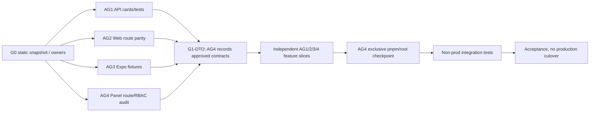

# GAFUS Refactor — запуск четырёх агентов после G0

**Контрольная точка:** `G0-2026-10-16-vite-5fc78081`. **Текущая ветка:** `vite`. **Разрешённый корень:** `/Users/asmtv1/Desktop/gafus-refactor`. **Один Git working tree; четыре непересекающихся владельца исходников.**

## Решение о готовности

**READY FOR PARALLEL G1 PREPARATION / LIMITED G2.** G0 статическая инвентаризация и эксклюзивные владельцы **зафиксированы**. Существующие API method/path — в неизменяемом BASELINE; **семантические DTO, все role/owner policies и полная 1:1 миграция ещё НЕ утверждены**. Это разрешает четыре параллельных потока **в своих файлах**, но не разрешает одновременно менять root dependencies, DB, Git, общий API contract или включать недоказанные endpoint. Статус G3/G4 = BLOCKED/NOT_STARTED.

Важное правило: **не запускать все четыре агента с командой «реализуй весь план»**. Каждый агент начинает с точно выделенного пакета работ ниже, затем идёт по своему AGENT_N_PLAN.md только после готовности зависимостей.

## Стартовый preflight для каждого агента

```sh
ROOT=/Users/asmtv1/Desktop/gafus-refactor
[ "$(git -C "$ROOT" rev-parse --show-toplevel)" = "$ROOT" ] || exit 1
[ "$(cd "$ROOT" && pwd -P)" = "$ROOT" ] || exit 1
[ "$(git -C "$ROOT" branch --show-current)" = "vite" ] || exit 1
git -C "$ROOT" status --short
# Перед каждой записью проверить собственника в OWNERSHIP.json,
# отсутствие symlink в каждом компоненте пути, существующий diff.
# Все команды/логи/временные файлы строго внутри ROOT, только AI Commander.
```

**Запрещено:** любая операция за пределами ROOT, доступ к GAFUS Main, follow symlink, production DB/S3/CDN/DNS/CI/deploy, чтение production secrets, push без явного запроса, force/reset/clean/rebase/merge/checkout, неоговорённые Git commits, root pnpm install, общие БД-тесты без AG4 gate.

## Параллельный пакет №1 — четыре независимые задачи

### AG1 — Backend contracts / G1-API-001
**Изменяет только:** `apps/api/**`, серверные `packages/**` из OWNERSHIP.json, `docs/refactor/agents/AGENT_1_PLAN.md`. **Читает:** legacy Web/Trainer/Admin actions и Mobile API. **Не пишет:** клиентские приложения, root lockfile, общие docs.

1. Прочитать `BASELINE.json.hono` (205), Web 109 Next API и 73 actions, Trainer 50, Admin 20, Mobile 37 adapters; сгруппировать по доменам и назначить каждому operation ID.
2. Начать с `auth/me/login/register/refresh/logout`, `public/courses`, `courses`, `user/profile`, `pets`, `articles`: заполнить карточки из CONTRACT_FREEZE.md с точным Zod, ответом, error/status, side effects, auth cookie/native.
3. Декомпозировать `ALL /questions/*`, `ALL /feed/*`, `ALL /gallery/*` по фактическим dispatch действиям и service, без добавления дублирующей логики.
4. Отдельно классифицировать отсутствующие Trainer/Admin endpoints и роль TRAINER/MODERATOR/ADMIN; для спорных операций статус BLOCKED_POLICY.
5. Добавить characterization/contract tests в AG1-owned директориях с mock services: browser cookie vs Expo Bearer, 401/403/409/429/500, wrong owner, replay. Не запускать реальную БД/платёж.
6. Отправить AG4 в своём журнале `G1-API-001 REPORT`: список FROZEN_CANDIDATE, DRAFT, MISSING, exact fixtures, test commands/exit, requests to consumers.

**Выход AG1 первого пакета:** карточки и тесты для подтверждённых базовых маршрутов, реестр missing endpoints, **без breaking change**; 205 деклараций классифицированы хотя бы как STATIC_CONFIRMED / DISPATCH_REVIEW / POLICY_PENDING. Нет карточки — не разблокировать новый UI consumer.

### AG2 — Web URL parity / G1-WEB-001
**Изменяет только:** `apps/web/**`, `apps/web-vite/**`, AG2 packages из OWNERSHIP.json, `AGENT_2_PLAN.md`. **Не пишет:** Hono, Mobile, панели, root lockfile.

1. Из `BASELINE.json.web.pages` составить **ровно 55 строк** `old URL/file → new Vite URL/component → auth → query → API → status → E2E ID`. Не удалять старый Next.
2. Для 109 Next API routes и 73 server-action modules назначить потребителя и AG1 backend dependency; пометить 85 STATIC_PATH_ONLY / 24 DISPATCH_REVIEW / 18 NOT_MATCHED / 17 LEGACY_NON_V1 по **HTTP-операциям**, не выдавать их за готовые контракты.
3. Сохранить существующий History API router (ADR-016); добавить только не требующие новых контрактов route/deep-link/404/redirect characterization tests. Не ставить React Router без ADR.
4. В существующем Vite добавить/уточнить unit/component tests auth cache isolation, online-only UX, PWA retirement с cache deletion disabled; не удалять browser offline queue до AG2-PWA-070 ACK.
5. Разработать visual/SEO acceptance matrix для всех публичных URL, но не считать клиентский document.title полноценным SEO.
6. Отчёт `G1-WEB-001 REPORT`: 55/55 URL mapped, 109 API +73 actions mapped to AG1, список блокеров, реально запущенные тесты.

**Выход AG2 первого пакета:** проверяемая матрица маршрутов/потребителей и безопасные UI/route тесты на mock; **без полного cutover, без PWA data deletion**.

### AG3 — Expo compatibility / G1-MOB-001
**Изменяет только:** `apps/mobile/**` и `AGENT_3_PLAN.md`. **Не пишет:** Hono/Core/types/root lockfile, Web или панели.

1. `BASELINE.json.mobile`: 66 Expo route files (включая layouts), 37 API adapters; отметить реально пользовательские экраны, каждую request method/path, platform IOS/ANDROID, auth, offline, push, payment, deep-link.
2. Зафиксировать из текущих тестов/адаптеров **старый JSON контракт** login/register/refresh/me, courses, training, pets, feed, questions, consultations, app-subscription. Без обращения к production и без реальных токенов.
3. Добавить или уточнить tests single-flight refresh, transient 503 keeps refresh token, USER-A→B cache isolation, offline queue ACK/idempotency, native HLS file retention. Не переписывать существующие stores.
4. Составить negative compatibility matrix для AG1: required/optional/null fields, error codes, old app version/OTA, user switching, media links, entitlement.
5. Отчёт `G1-MOB-001 REPORT`: список API compatibility MUST_KEEP, тесты/exit, blocked device tests.

**Выход AG3 первого пакета:** подтверждённые native fixtures и safety tests; Expo offline/push untouched, no production EAS/OTA.

### AG4 — Trainer/Admin audit + coordination / G1-PANEL-001
**Изменяет только:** `apps/trainer-panel/**`, `apps/admin-panel/**`, AG4 infra/test paths, `AGENT_4_PLAN.md`; общие docs — **в сериализованном окне**.

1. Зафиксировать 29 Trainer и 21 Admin page URL, 50/20 server-action modules, 6/5 `/api/*` routes, 1 Trainer non-API video upload route. Каждому exported action — target Hono contract/owner/RBAC/audit/negative test.
2. Составить Trainer/Admin role matrix: USER, PARTNER, TRAINER-A/B, MODERATOR, ADMIN; no privilege inheritance assumptions. Любой неизвестный owner check → BLOCKED_BY_AG1.
3. Подготовить два Vite frontend designs в panel-owned файлах, **не** удаляя Next и не создавая фиктивных API. Начать mock-only unit/router/visual tests без root install.
4. Подтвердить shared write calendar: pnpm lockfile importer `apps/web-vite` отсутствует. Запретить параллельный install, Prisma generate, root build, Git commits и общие DB tests.
5. Собрать отчёты AG1/2/3, согласовать G1-DTO-N, затем в эксклюзивном окне обновить `DECISIONS.md`, `PROGRESS.md`, `ROADMAP.md` и coordination docs.
6. Отчёт `G1-PANEL-001 REPORT`: 100% панельных route/action статически назначены, role matrix, missing endpoints, conflict-free schedule.

**Выход AG4 первого пакета:** панельные операции имеют владельцев и блокеры, общий G1 gate записан; ни одного production action.

## Схема блокировок между задачами



**Временное правило:** пока G1-DTO не закрыт, разрешено только (а) статическая инвентаризация, (б) characterization/contract tests на существующем API, (в) независимый mock-only UI/route/scaffold, (г) нативные fixture/offline regression tests. Любое новое реальное API взаимодействие, изменение shared DTO, auth или schema — только после G1-DTO и approvals.

## Порядок эксклюзивных окон

| Окно | AG1 | AG2 | AG3 | AG4 | Выход |
|---|---|---|---|---|---|
| P0 independent | собственный backend/tests | Web/tests | Mobile/tests | panels/tests | ни одного пересекающегося файла |
| G1 contract | публикует draft | reviews Web | reviews Expo | reviews panels/records | G1-DTO-N FROZEN или BLOCKED |
| Dependency checkpoint | **stop installs/DB/Git** | **stop installs/DB/Git** | **stop installs/DB/Git** | только AG4 root pnpm/lockfile | frozen install verified или BLOCKED |
| G2 slices | additive API | Web adapters/UI | native compat | panel adapters/UI | feature-level DoD |
| G3 integration | помогает по дефектам | помогает по дефектам | device tests | ведёт isolated E2E | full cross-client evidence |
| G4 release review | reports | reports | reports | acceptance docs | **без production deploy** |

Окно начинается только после записи AG4 в `docs/refactor/PROGRESS.md`: `WINDOW ID / owner / files / time / tests / rollback`. В общем Git working tree никакой агент не переключает ветку/не создаёт коммит одновременно с другим.

## Передача результата каждого агента (в его AGENT_N_PLAN.md)

```text
REPORT ID / task ID:
Snapshot: G0-2026-10-16-vite-5fc78081; current branch/head:
Owned files changed (exact paths):
Old behavior → new behavior / API contract revision:
Tests actually run (command, exit code, cases):
Tests not run + reason (BLOCKED, never PASS):
Negative security / ownership / replay / offline:
Dependency on AG1/AG2/AG3/AG4:
Git status/diff check; existing dirty files preserved:
Rollback (own changes only):
Status: COMPLETE / PARTIAL / BLOCKED / FAILED
Next unlocked task:
```

**Критерий завершения первого параллельного пакета:** 55 Web URL + 109 Next API + 73 Web actions, 29 Trainer URL + 50 Trainer actions, 21 Admin URL + 20 Admin actions, 66 Mobile route files + 37 adapters, 205 Hono declarations получили owner и явный статус/блокер; базовые auth/catalog/profile contract cards и native fixtures подтверждены реальными тестами; AG4 записал G1-DTO-N либо честный список незакрытых контрактов. Никакого ложного «весь рефактор завершён».

## Известные блокеры и как их обходить безопасно

- **Workspace:** `apps/web-vite` отсутствует в `pnpm-lock.yaml`; AG4 решает только в отдельном root checkpoint. Не обходить ручным изменением lockfile или запуском install в параллельном окне.
- **API semantics:** 205 declarations ≠ 205 полностью специфицированных операций; wildcard и Server Actions требуют AG1 ручной карты.
- **Legacy dirty files:** Git status уже содержит изменения API/Core, Trainer/Admin middleware/layout и untracked Vite/docs. Нельзя обнулять/перезаписывать.
- **Symlink:** в старых docs отмечены внешние ClickHouse links; не следовать им. Глобальная проверка всех generated node_modules/build artifacts в этом G0 не проводилась.
- **Browser PWA:** Web/панели должны стать полностью non-PWA, но пользовательские browser queues и legacy SW нельзя удалять до ACK; Expo offline/push остаются.
- **Runtime:** реальные HTTPS cookies, Postgres/Redis/S3, device E2E, payment sandbox и SEO crawler пока не доказаны. G3/G4 не PASS.


**Готовые отдельные промпты для запуска:** `docs/refactor/coordination/LAUNCH_PROMPTS.md` — четыре автономных сообщения, по одному в каждый чат/агент.

**Машинные gates:** `docs/refactor/coordination/GATES.json`; разрешён только P0_PARALLEL_PREPARATION, все общие ресурсы LOCKED до AG4 checkpoint.
